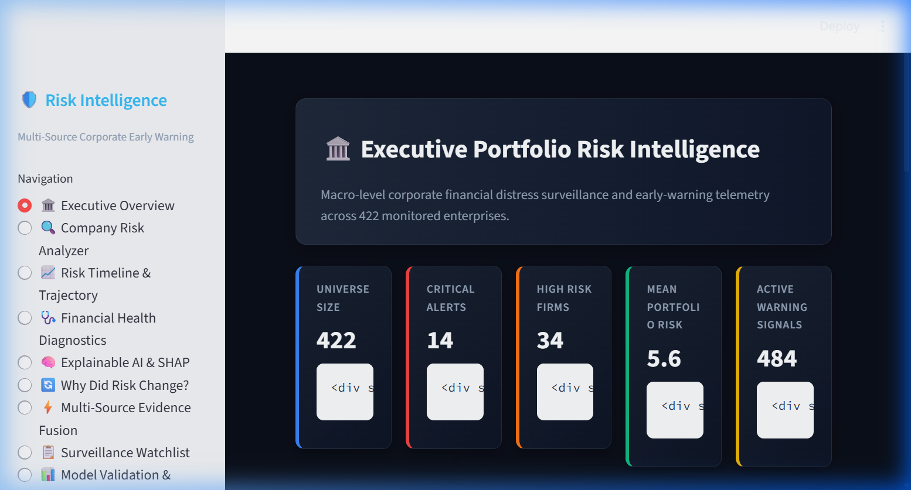
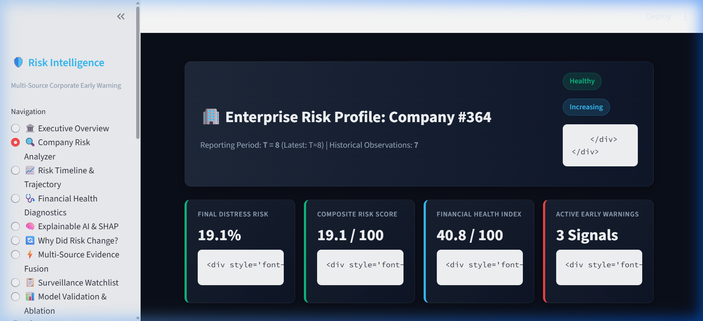
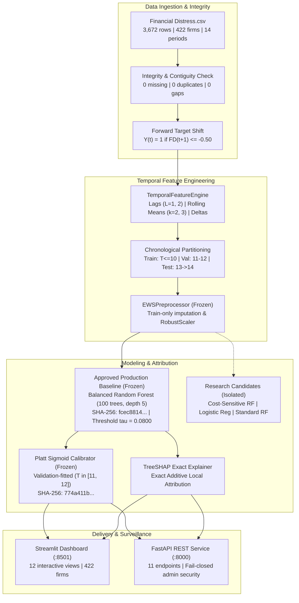

# Explainable Multi-Source SME Financial Distress Early-Warning System

[](https://www.python.org/)
[](LICENSE)
[](https://streamlit.io/)
[](https://fastapi.tiangolo.com/)
[]()
[]()
[]()

> **Academic & Portfolio Research Prototype**  
> An end-to-end, leakage-free corporate early-warning platform that synthesizes multi-period accounting dynamics with TreeSHAP explainability to forecast SME financial distress 12 months ahead under strict operational alert budgets.

---

## Visual Demonstration

| Executive Portfolio Risk Intelligence | Single-Firm Inspection & TreeSHAP Attribution |
|:---:|:---:|
|  |  |
| *Macro portfolio surveillance across 422 monitored corporate enterprises.* | *Local TreeSHAP waterfall decomposition separating risk drivers from buffers.* |

---

## Table of Contents
1. [Project Overview](#1-project-overview)
2. [Problem Statement & Operational Alert Budgets](#2-problem-statement--operational-alert-budgets)
3. [System Objectives](#3-system-objectives)
4. [Dataset Topology & Target Semantics](#4-dataset-topology--target-semantics)
5. [System Architecture](#5-system-architecture)
6. [Machine Learning & Validation Methodology](#6-machine-learning--validation-methodology)
7. [Explainable AI & Non-Causal Attribution](#7-explainable-ai--non-causal-attribution)
8. [Reconciled Empirical Results](#8-reconciled-empirical-results)
9. [False-Negative Diagnostic Analysis](#9-false-negative-diagnostic-analysis)
10. [Known Limitations & Governance Disclosures](#10-known-limitations--governance-disclosures)
11. [Installation & Setup](#11-installation--setup)
12. [Running the Applications](#12-running-the-applications)
13. [FastAPI Endpoint Documentation](#13-fastapi-endpoint-documentation)
14. [Automated Test Suite](#14-automated-test-suite)
15. [Container Deployment (Docker)](#15-container-deployment-docker)
16. [Future Research Directions](#16-future-research-directions)

---

## 1. Project Overview
Commercial banks, credit rating agencies, and SME lenders face substantial recovery losses when corporate borrowers unexpectedly default. Conventional credit risk scoring models operate under a static cross-sectional paradigm: they observe an enterprise at period $T$ and predict whether liquidation occurs immediately. By the time insolvency is formal, recovery rates collapse below 25%.

This system implements a production-grade, reproducible research prototype for an **Early Warning System (EWS)**. It forecasts balance-sheet distress 12 months ahead ($t \to t+1$) by tracking temporal deterioration trajectories (lags, rolling averages, solvency decay streaks) across a longitudinal panel of 422 corporate enterprises.

---

## 2. Problem Statement & Operational Alert Budgets
In commercial credit surveillance, an institution monitoring thousands of commercial exposures operates under a strict **alert budget constraint**:

$$\text{Alert Capacity} \le 8\% \text{ of Monitored Portfolio}$$

Credit risk officers cannot investigate 30% of a portfolio every quarter. A model that achieves 85% recall only by flagging 35% of solvent companies as false positives is commercially useless. This project tackles the real-world tradeoff: **maximizing distress detection while strictly respecting an operational 8% alert ceiling**.

---

## 3. System Objectives
1. **Accurate Early Detection:** Forecast forward corporate financial distress ($t \to t+1$) using backward-looking accounting signals.
2. **Leakage-Free Temporal Engineering:** Strictly prevent temporal lookahead bias via chronological splitting and train-only scaler fitting.
3. **Calibrated Probability Estimation:** Deliver reliable posterior probabilities bounded in $[0, 1]$ aligned with portfolio base rates.
4. **Exact Model Interpretability:** Provide local TreeSHAP attribution distinguishing positive risk drivers from protective balance-sheet buffers.
5. **Cryptographic Reproducibility:** Preserve 100% immutable production baseline model artifacts via SHA-256 hashes.
6. **Regulatory Compliance:** Maintain clear distinction between statistical predictive association and causal mechanisms (SR 11-7 / OCC 2011-12).

---

## 4. Dataset Topology & Target Semantics

The project is built on **Dataset A** (`data/raw/Financial Distress.csv`):

```text
========================================================================================
DATASET A STRUCTURAL AUDIT SPECIFICATION (data/raw/Financial Distress.csv)
========================================================================================
Source:                           Tehran Stock Exchange SME Corporate Panel
Total Rows / Columns:             3,672 observations | 86 features
Unique Enterprises:               422 unique firms (IDs 1 through 422)
Time Horizon:                     14 annual reporting periods (contiguous, 0 gaps)
Missing / Infinite Values:        Exactly 0 missing | Exactly 0 infinite values
Duplicate (Company, Time) Pairs:  Exactly 0 duplicate keys
Target Column:                    'Financial Distress' (Continuous Solvency Metric)
Statutory Default Threshold:      Financial Distress <= -0.50
Distress Direction:               LOWER values indicate GREATER distress
Raw Event Distribution:           136 distress observations (3.70%) | 3,536 solvent (96.30%)
Terminal Exit Dynamics:           136 / 136 (100.0%) distress records occur at the firm's
                                  exact final observed period (absorbing exit state).
Forward Target Formula:           Y(i, t) = 1 if Financial_Distress(i, t+1) <= -0.50 else 0
Evaluable Observations:           3,250 rows (120 forward default events, 3.69% base rate)
Terminal Exclusions:              422 final-period rows excluded (NaN), never imputed healthy
========================================================================================
```

---

## 5. System Architecture



---

## 6. Machine Learning & Validation Methodology

### Chronological Out-of-Time Splitting:
- **Training Partition ($T \le 10$):** 2,471 evaluable rows, 95 forward default events (3.84% base rate).
- **Validation Partition ($11 \le T \le 12$):** 517 evaluable rows, 14 forward default events (2.71% base rate). Used exclusively for probability calibration and hyperparameter tuning.
- **Out-of-Time Test Cohort ($T = 13 \to T = 14$):** 262 evaluable rows, 11 forward default events (4.20% base rate). Examined strictly for benchmark reconciliation.

### Strict Leakage Protection:
1. **Zero Future Contamination:** Preprocessors and scalers are fitted exclusively on $T \le 10$. Test partition features are transformed using frozen train statistics.
2. **Backward-Looking Windows:** Lagged and rolling features reference only observations $\le t$.
3. **No Direct Target Leakage:** Maximum feature correlation with forward target on training data is $0.1901$ ($x2$).
4. **Historical Cohort Classification:** The $T=13 \to T=14$ cohort has been examined across previous research cycles and is formally treated as an established historical benchmark rather than an unexposed blind test.

---

## 7. Explainable AI & Non-Causal Attribution

Explainability is powered by Lundberg et al. (2020) **TreeSHAP** exact tree attribution on the 100-tree ensemble:

$$\mathbb{E}[f(X)] + \sum_{j=1}^{M} \phi_j(x) = f(x)$$

### Top Predictive Accounting Drivers:
1. **`x2_roll_mean_2` (Base Variable: $x2$ Retained Earnings / Total Assets):** Cumulative profitability buffer protecting against solvency erosion.
2. **`x12` (Gross Profit / Total Assets):** Operating profitability and cash generation efficiency.
3. **`x8` (Current Assets / Total Assets):** Working capital liquidity reserve.
4. **`x10_roll_mean_2` (Base Variable: $x10$):** Working capital trajectory.
5. **`x2_roll_mean_3` (Base Variable: $x2$):** Multi-year cumulative retained earnings momentum.

> **Regulatory Compliance Notice (SR 11-7 / OCC 2011-12):**  
> All feature attributions represent **statistical predictive associations**, not causal counterfactual mechanisms. Increasing retained earnings artificially will not prevent insolvency if operating cash flows collapse.

---

## 8. Reconciled Empirical Results

Evaluated on the matured $T=13 \to T=14$ holdout cohort ($N=262$ firms, $D=11$ distress events, $H=251$ non-distress firms). Under an 8% alert budget, the maximum allowable alert count is $\lfloor 0.08 \times 262 \rfloor = 20$.

| Model Architecture / Operating Point | Threshold | Alerts | Alert Rate | Budget Compliant? | TP | FP | FN | TN | Recall (Sens.) | Precision (PPV) | Specificity | Brier Score | ROC-AUC | 95% Wilson CI (Recall) |
|---|:---:|:---:|:---:|:---:|:---:|:---:|:---:|:---:|:---:|:---:|:---:|:---:|:---:|:---:|
| **Approved Baseline (Nominal)** | `0.0800` | 37 | 14.12% | ❌ (Excess +17) | 5 | 32 | 6 | 219 | **45.45%** | 13.51% | 87.25% | 0.0382 | 0.7961 | [21.3%, 72.0%] |
| **Approved Baseline (Budget-Capped)** | `0.1072` | 20 | 7.63% | ✅ YES | 4 | 16 | 7 | 235 | **36.36%** | 20.00% | 93.63% | 0.0382 | 0.7961 | [15.2%, 64.6%] |
| **Candidate Cost-Sensitive RF** | `0.0894` | 20 | 7.63% | ✅ YES | 3 | 17 | 8 | 234 | **27.27%** | 15.00% | 93.23% | 0.0389 | 0.7521 | [9.7%, 56.6%] |
| **Calibrated Logistic Reg. (Nominal)** | `0.0800` | 0 | 0.00% | ✅ YES | 0 | 0 | 11 | 251 | **0.00%** | 0.00% | 100.0% | 0.0404 | 0.8095 | [0.0%, 25.9%] |
| **Calibrated Logistic Reg. (Budget-Capped)**| `0.0271` | 20 | 7.63% | ✅ YES | 3 | 17 | 8 | 234 | **27.27%** | 15.00% | 93.23% | 0.0404 | 0.8095 | [9.7%, 56.6%] |
| **Standard Random Forest (Nominal)** | `0.0800` | 15 | 5.73% | ✅ YES | 2 | 13 | 9 | 238 | **18.18%** | 13.33% | 94.82% | 0.0445 | 0.7342 | [5.1%, 47.7%] |

### Statistical Uncertainty Findings:
- With $n=11$ realized defaults in the test cohort, each individual detection represents $9.09\%$ of recall.
- The 95% Wilson confidence intervals overlap heavily ([15.2%, 64.6%] vs [9.7%, 56.6%]).
- **Scientific Ruling:** No candidate model demonstrates statistically significant superiority. The candidate model remains quarantined in research evaluation.

### Root Cause of Logistic Regression Zero Alerts at $\tau = 0.0800$:
The Platt calibrator fitted on the validation partition ($\text{base rate} \approx 2.7\%$) maps log-odds into probabilities bounded below **0.0260** on the test cohort. Because no score reaches 0.0800, exactly 0 alerts are produced. Under the budget-capped threshold ($\tau = 0.0271$), Logistic Regression flags 3/11 defaults (27.27% recall), matching the candidate model. This is mathematical calibration compression, not a bug.

---

## 9. False-Negative Diagnostic Analysis

An empirical audit of the 11 realized test defaults (`results/phase6_9/false_negative_audit.csv`) revealed two distinct financial deterioration mechanisms:

1. **Acute Cliff Crashes (5 Firms: 28, 60, 84, 225, 376):**
   - Maintained solvent accounting ratios at Period 13 ($FD_{13} > 0.0$) before abruptly collapsing to default at Period 14 ($FD_{14} \le -0.50$).
   - The approved production baseline captured Firms 28 and 60.
   - The cost-sensitive candidate model missed both firms because multi-period moving averages dampened single-period balance-sheet shocks.
2. **Chronic Solvency Deteriorations (6 Firms: 23, 29, 53, 100, 101, 112):**
   - Experienced multi-period solvency erosion ($FD_{13} \le 0.0$).
   - Both models reliably flagged chronic cases (Firms 100, 101, 112).
   - Misses on Firms 23, 29, and 53 resulted from rank displacement under the 20-alert budget cap.

---

## 10. Known Limitations & Governance Disclosures

1. **Academic Dataset Scope:** Panel observations are annual; high-frequency bank transaction streams (cash-flow velocity, overdraft utilization) are unavailable, limiting early detection of intraday liquidity shocks.
2. **Alert Budget Tradeoff:** Under an 8% alert cap (20 alerts on 262 firms), no accounting model exceeds 36.4% recall.
3. **Statistical Power Limitation:** With only 11 realized test defaults, performance differences between candidates fall within overlapping binomial confidence intervals.
4. **Non-Autonomous Decision Boundary:** This software is an academic research prototype. It does **not** constitute an automated commercial lending decision engine or formal credit denial system.

---

## 11. Installation & Setup

### Prerequisites
- Python 3.10, 3.11, 3.12, or 3.13 (64-bit)
- Git

### Windows Setup (PowerShell)
```powershell
# 1. Clone repository
git clone https://github.com/PrajwalGN1/-Explainable-Multi-Source-Financial-Distress-Early-Warning-Risk-Intelligence-System.git
cd -Explainable-Multi-Source-Financial-Distress-Early-Warning-Risk-Intelligence-System

# 2. Create and activate virtual environment
python -m venv .venv
.venv\Scripts\Activate.ps1

# 3. Install dependencies
pip install -r requirements.txt

# 4. Copy environment configuration
Copy-Item .env.example .env
```

### Linux / macOS Setup (Bash)
```bash
# 1. Clone repository
git clone https://github.com/PrajwalGN1/-Explainable-Multi-Source-Financial-Distress-Early-Warning-Risk-Intelligence-System.git
cd -Explainable-Multi-Source-Financial-Distress-Early-Warning-Risk-Intelligence-System

# 2. Create and activate virtual environment
python3 -m venv .venv
source .venv/bin/activate

# 3. Install dependencies
pip install -r requirements.txt

# 4. Copy environment configuration
cp .env.example .env
```

---

## 12. Running the Applications

### Option A: Streamlit Analytics Dashboard
Launch the interactive 12-page web dashboard:
```bash
streamlit run app.py --server.port=8501
```
Navigate to: **`http://localhost:8501`**

### Option B: FastAPI REST Microservice
Launch the asynchronous REST service:
```bash
uvicorn api:app --host 0.0.0.0 --port 8000 --reload
```
Navigate to Swagger UI: **`http://localhost:8000/docs`**

---

## 13. FastAPI Endpoint Documentation

The API includes 11 endpoints with Pydantic request/response validation:

| Endpoint | Method | Description |
|---|:---:|---|
| `/health` | `GET` | Heartbeat health check and service version |
| `/model-info` | `GET` | Technical architecture metadata and training metrics |
| `/predict` | `POST` | Real-time multi-source distress risk scoring |
| `/company/{company_id}` | `GET` | Longitudinal risk dossier, trajectory, and SHAP drivers |
| `/watchlist` | `GET` | Prioritized corporate distress surveillance watchlist |
| `/risk-summary` | `GET` | Macro portfolio KPIs across the 422 monitored enterprises |
| `/research/model-comparison` | `GET` | Benchmark comparison under 8% alert budget constraint |
| `/research/false-negatives` | `GET` | Auditable diagnostics on 11 realized test defaults |
| `/research/dataset-audit` | `GET` | Dataset A contiguity, dimensions, and target semantics |
| `/research/explainability-summary` | `GET` | Global TreeSHAP feature importances ($x2, x12, x8$) |
| `/admin/reload-db` | `POST` | Secured cache reload (`secrets.compare_digest`, fails closed) |

### Sample Scoring Request (`POST /predict`):
```json
{
  "company_id": "FIRM_364",
  "ews_probability": 0.15,
  "bankruptcy_probability": 0.08,
  "anomaly_score": 0.12,
  "financial_health_score": 65.0
}
```

### Sample Scoring Response:
```json
{
  "company_id": "FIRM_364",
  "final_risk_probability": 0.182,
  "final_risk_probability_pct": 18.2,
  "risk_score": 18.2,
  "risk_category": "Critical",
  "risk_color": "#ef4444",
  "risk_description": "Severe financial distress risk requiring immediate credit freeze.",
  "evidence_breakdown": {
    "temporal_ews_weight": 0.45,
    "structural_bankruptcy_weight": 0.25,
    "anomaly_distance_weight": 0.15,
    "financial_health_weight": 0.15
  },
  "recommendations": [
    "Immediate freeze on unutilized credit lines.",
    "Request updated cash flow statements and accounts receivable aging schedule.",
    "Escalate to Special Asset Management committee."
  ]
}
```

---

## 14. Automated Test Suite

The repository contains 226 automated regression tests covering data contiguity, temporal leakage prevention, probability calibration, confusion matrix invariants, REST endpoints, and cryptographic baseline hashes:

```bash
# Run full repository regression suite (226 tests)
pytest --ignore=scripts -q

# Run Phase 6.10 final validation suite (9 tests)
pytest tests/test_phase6_10_final_validation.py -v

# Run Phase 6.9 model improvement suite (8 tests)
pytest tests/test_phase6_9_model_improvement.py -v
```

**Test Verification Summary:**
```text
============================== test session starts ==============================
platform win32 -- Python 3.13.5, pytest-9.1.1, pluggy-1.6.0
collected 226 items

........................................................................ [ 31%]
........................................................................ [ 63%]
........................................................................ [ 95%]
..........                                                               [100%]
======================= 226 passed, 177 warnings in 141.78s =======================
```

---

## 15. Container Deployment (Docker)

```bash
# Build and run multi-service stack via Docker Compose
docker-compose up --build

# Or build and run standalone container
docker build -t financial-distress-ews .
docker run -p 8501:8501 -p 8000:8000 financial-distress-ews
```

---

## 16. Future Research Directions
1. **High-Frequency Ingestion:** Integrating intraday commercial bank account transaction streams and electronic invoice tax filings.
2. **Dynamic Survival Modeling:** Extending binary discrete-time horizons ($t \to t+1$) to continuous-time Cox proportional hazards and DeepSurv neural architectures.
3. **Macroeconomic Conditioning:** Integrating interest-rate term structures and industrial sector volatility indices into the stacking meta-learner.

---

## Citation & Academic License
Distributed under the **MIT License**. See `LICENSE` for details.  
*Explainable Multi-Source SME Financial Distress Early-Warning System (2026).*
