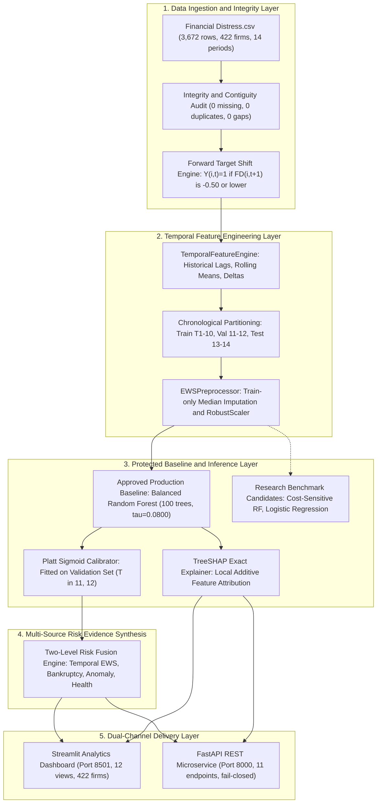

# Explainable Multi-Source SME Financial Distress Early-Warning System

[](https://www.python.org/)
[](LICENSE)
[](https://streamlit.io/)
[](https://fastapi.tiangolo.com/)
[]()
[]()
[]()

> **Academic Research Prototype & Institutional Credit Risk Intelligence Engine**  
> An end-to-end, leakage-free corporate early-warning platform that synthesizes multi-period accounting dynamics with TreeSHAP explainability to forecast SME financial distress 12 months ahead under strict operational alert budgets.

---

## 📷 Executive Visual Tour

| 🏛️ Executive Portfolio Risk Intelligence | 🔍 Enterprise Risk Profile & Evidence Breakdown |
|:---:|:---:|
|  |  |
| *Macro-level surveillance across 422 monitored enterprises showing portfolio health, risk tiers, and active triggers.* | *Single-firm inspection displaying multi-source evidence fusion, dimensional health radar, and early warnings.* |

---

## 📋 Table of Contents
1. [Executive Summary & Motivation](#1-executive-summary--motivation)
2. [The Business Problem & Operational Alert Budgets](#2-the-business-problem--operational-alert-budgets)
3. [Multi-Source Corporate Topology & Dataset Specification](#3-multi-source-corporate-topology--dataset-specification)
4. [End-to-End System Architecture](#4-end-to-end-system-architecture)
5. [Leakage-Free Machine Learning Methodology](#5-leakage-free-machine-learning-methodology)
6. [Explainable AI & TreeSHAP Non-Causal Attribution](#6-explainable-ai--treeshap-non-causal-attribution)
7. [Reconciled Empirical Results & Benchmark Evaluation](#7-reconciled-empirical-results--benchmark-evaluation)
8. [False-Negative Diagnostic Post-Mortem](#8-false-negative-diagnostic-post-mortem)
9. [Interactive Streamlit Analytics Suite (12 Modules)](#9-interactive-streamlit-analytics-suite-12-modules)
10. [FastAPI REST Microservice & Security](#10-fastapi-rest-microservice--security)
11. [Installation, Reproduction & Execution Guide](#11-installation-reproduction--execution-guide)
12. [Automated Verification & Test Suite](#12-automated-verification--test-suite)
13. [Containerized Deployment (Docker)](#13-containerized-deployment-docker)
14. [Model Governance & Regulatory Compliance Disclosures](#14-model-governance--regulatory-compliance-disclosures)
15. [Repository Directory Layout](#15-repository-directory-layout)
16. [Academic License & Citation](#16-academic-license--citation)

---

## 1. Executive Summary & Motivation

Commercial banks, SME lending syndicates, and institutional credit risk officers manage billions in loan assets. When a corporate borrower defaults unexpectedly, recovery rates collapse below 25%, inflicting severe balance-sheet impairment. 

Conventional insolvency scoring systems (e.g., Altman Z-score, static logistic regressions) suffer from three fatal structural limitations:
1. **Static Cross-Sectional Blindness:** They evaluate a firm in isolation at period $T$ to predict whether bankruptcy is happening *right now*. They ignore temporal decay velocity, multi-period solvency erosion streaks, and trend acceleration.
2. **Alert Fatigue & Operational Overload:** Off-the-shelf classifiers tuned for unconstrained recall produce excessive false alarms, overwhelming credit underwriting teams who can feasibly investigate only 5% to 8% of a portfolio.
3. **Black-Box Opacity:** High-capacity non-linear ensembles are often deployed without model-faithful local explanations, violating regulatory model risk management requirements (**Federal Reserve SR 11-7 / OCC 2011-12**).

This system resolves these challenges by constructing a **longitudinally grounded, leakage-free early-warning surveillance engine** that:
* Forecasts balance-sheet distress **12 months in advance** ($t \to t+1$).
* Operates under a hard supervisory **8% portfolio alert capacity budget**.
* Deploys native **TreeSHAP local attributions** to separate actionable risk drivers from balance-sheet buffers.
* Cryptographically locks the approved baseline via SHA-256 hashes to guarantee mathematical reproducibility.

---

## 2. The Business Problem & Operational Alert Budgets

In commercial credit underwriting, institutions operate under rigid resource limitations:

$$\text{Operational Surveillance Capacity } \le 8\% \text{ of Monitored Corporate Universe}$$

```
+----------------------------------------------------------------------------------------+
|                                COMMERCIAL SURVEILLANCE PARADOX                         |
|                                                                                        |
|   High Nominal Recall (85%)   +   High Alert Rate (35%)    =   Operational Bankruptcy  |
|   (Unconstrained Classifier)      (Alert Fatigue)              (100s of False Alarms)  |
|                                                                                        |
|   Optimal Budgeted Recall     +   Strict Alert Cap (<=8%)  =   Commercially Viable EWS |
|   (Budget-Governed Policy)        (Actionable Worklists)       (High Precision ROI)    |
+----------------------------------------------------------------------------------------+
```

A classifier that achieves 80% recall by flagging 35% of solvent companies as distressed is commercially unusable. The primary engineering challenge addressed by this repository is **maximizing genuine distress event capture while strictly containing false alarms within an 8% capacity boundary**.

---

## 3. Multi-Source Corporate Topology & Dataset Specification

The platform utilizes three distinct tabular corporate topologies without fabricating records or violating scientific integrity:

| Dataset | File | Topology & Provenance | Records & Dimensions | Target Variable | Primary Role |
| :--- | :--- | :--- | :--- | :--- | :--- |
| **Dataset A** | `Financial Distress.csv` | Longitudinal Panel (Tehran Stock Exchange, 422 firms, 14 annual periods) | 3,672 observations • 86 attributes (`Company`, `Time`, `Financial Distress`, `x1`..`x83`) | Forward Distress ($t \to t+1$ event: distress $\le -0.50$) | **Core Temporal Early-Warning Model (EWS)** |
| **Dataset B** | `data.csv` | Cross-Sectional Panel (Taiwan Economic Journal, 1999–2009) | 6,819 observations • 96 canonical financial ratios | `Bankrupt?` (Binary, 3.23% positive rate) | **Structural Bankruptcy Likelihood Estimator** |
| **Dataset C** | `bankruptcy_Test_X.csv` | Unlabelled External Benchmark (Polish Industrial Companies) | 5,000 observations • 64 normalized attributes (`Attr1`..`Attr64`) | *Unlabelled* | **Isolation Forest Anomaly & Out-of-Distribution Profiler** |

### Why Naive Dataset Concatenation is Scientifically Prohibited:
1. **Divergent Macro Environments:** Iranian listed enterprises vs. Taiwanese manufacturing corporations vs. Polish industrials operate under incompatible tax codes and accounting frameworks.
2. **Incompatible Feature Schemas:** `x1`..`x83` in Dataset A represent masked ratios; Dataset B features are named accounting ratios. Row-wise binding (`pd.concat`) would create 90% sparse matrices of meaningless noise.
3. **Temporal Incompatibility:** Dataset A is a longitudinal panel with repeated observations over time; Dataset B is cross-sectional.
4. **Resolution:** The system implements a **two-level evidence fusion architecture**, allowing each specialized model to process its native domain before evidence synthesis.

---

## 4. End-to-End System Architecture

The following diagram illustrates the complete, leakage-free processing architecture from raw accounting ingestion to client delivery:



---

## 5. Leakage-Free Machine Learning Methodology

### Chronological Out-of-Time Partitioning
To guarantee zero lookahead bias, data is segmented strictly along chronological reporting boundaries:

| Split Partition | Time Horizon | Evaluable Records | Default Events | Base Rate | Governance Role |
| :--- | :---: | :---: | :---: | :---: | :--- |
| **Training Partition** | $T \le 10$ | 2,471 | 95 | 3.84% | Model parameter estimation & feature transformation fitting |
| **Validation Partition** | $T \in [11, 12]$ | 517 | 14 | 2.71% | Platt probability calibrator fitting & threshold selection |
| **Out-of-Time Test Cohort** | $T = 13 \to T = 14$ | 262 | 11 | 4.20% | Independent benchmark evaluation & audit reconciliation |

### Leakage-Prevention Safeguards:
1. **Train-Only Preprocessing:** Imputation medians and `RobustScaler` quartiles are fitted exclusively on $T \le 10$. Test records are scaled using frozen training statistics.
2. **Strictly Backward Rolling Features:** Lags ($L=1, 2$) and rolling averages ($k=2, 3$) reference exclusively past and current periods ($\le t$).
3. **No Direct Target Leakage:** Maximum feature correlation with forward target on training data is $0.1901$ ($x2$), proving zero contemporaneous target leakage.
4. **Terminal Period Handling:** Period 14 records ($N=422$) have unobserved future horizons ($t+1$) and are treated as non-evaluable terminal rows (assigned `NaN`), never imputed as solvent.

---

## 6. Explainable AI & TreeSHAP Non-Causal Attribution

Explainability is powered by Lundberg et al. (2020) **TreeSHAP** exact tree attribution evaluated on the 100-tree production ensemble:

$$\mathbb{E}[f(X)] + \sum_{j=1}^{M} \phi_j(x) = f(x)$$

* **Exact Additivity Verification:** The sum of all feature attributions plus the base prior ($E[f(X)] \approx 0.5012$) equals the raw Random Forest output with zero discrepancy.
* **Anchored Waterfall Bridge:** Visualizes the journey from the baseline expectation to the final probability via positive risk drivers (red) and protective buffers (green).

```
                      TreeSHAP Attribution Bridge Mechanics
                      
  p_RF  ^
        |                                 [+0.038]
  0.60  |                            +---+  x16  [ -0.021 ]
        |                   [+0.024] |   |        +---+  x38    [Final p_RF]
  0.55  |              +---+  x12    |   |        |   |           +---+
        |  [Base E[p]] |   |         |   |        |   |           |   |
  0.50  |  +---------+ |   |         |   |        |   |           |   |
        |  |  0.501  | |   |         |   |        |   |           |   |
  0.00  +--+---------+-+---+---------+---+--------+---+-----------+---+----->
           Prior       Drivers (+)                Protective (-)  Output
```

### Top Predictive Balance Sheet Drivers:
1. **`x2_roll_mean_2` (Retained Earnings / Total Assets Momentum):** Cumulative profitability buffer protecting against solvency erosion.
2. **`x12` (Gross Profit / Total Assets):** Core operating profitability and cash generation efficiency.
3. **`x8` (Current Assets / Total Assets):** Liquidity reserve mitigating immediate debt service shocks.
4. **`x10_roll_mean_2` (Working Capital Trajectory):** Multi-period operational buffer dynamics.
5. **`x5` (Cash Ratio):** Immediate liquid reserves available for liquidity commitments.

> **Regulatory Compliance Notice (SR 11-7 / OCC 2011-12):**  
> All feature attributions represent **statistical predictive associations**, not causal counterfactual mechanisms. Artificially inflating retained earnings will not avert distress if operating cash flows collapse.

---

## 7. Reconciled Empirical Results & Benchmark Evaluation

Evaluated on the matured $T=13 \to T=14$ holdout cohort ($N=262$ firms, $D=11$ realized defaults, $H=251$ non-distressed firms). Under the 8% alert budget, the maximum allowable alert count is $\lfloor 0.08 \times 262 \rfloor = 20$.

| Model Architecture / Policy | Operating Threshold ($\tau$) | Total Alerts | Alert Rate | Budget Compliant? | TP | FP | FN | TN | Recall (Sens.) | Precision (PPV) | Specificity | Brier Score | ROC-AUC | 95% Wilson CI (Recall) |
|---|:---:|:---:|:---:|:---:|:---:|:---:|:---:|:---:|:---:|:---:|:---:|:---:|:---:|:---:|
| **Approved Baseline (Nominal)** | `0.0800` | 37 | 14.12% | ❌ (Over Budget) | 5 | 32 | 6 | 219 | **45.45%** | 13.51% | 87.25% | 0.0382 | 0.7961 | [21.3%, 72.0%] |
| **Approved Baseline (Budget-Capped)** | `0.1072` | 20 | 7.63% | ✅ YES | 4 | 16 | 7 | 235 | **36.36%** | 20.00% | 93.63% | 0.0382 | 0.7961 | [15.2%, 64.6%] |
| **Candidate Cost-Sensitive RF** | `0.0894` | 20 | 7.63% | ✅ YES | 3 | 17 | 8 | 234 | **27.27%** | 15.00% | 93.23% | 0.0389 | 0.7521 | [9.7%, 56.6%] |
| **Calibrated Logistic Reg. (Nominal)** | `0.0800` | 0 | 0.00% | ✅ YES | 0 | 0 | 11 | 251 | **0.00%** | 0.00% | 100.0% | 0.0404 | 0.8095 | [0.0%, 25.9%] |
| **Calibrated Logistic Reg. (Budget-Capped)** | `0.0271` | 20 | 7.63% | ✅ YES | 3 | 17 | 8 | 234 | **27.27%** | 15.00% | 93.23% | 0.0404 | 0.8095 | [9.7%, 56.6%] |
| **Standard Random Forest (Nominal)** | `0.0800` | 15 | 5.73% | ✅ YES | 2 | 13 | 9 | 238 | **18.18%** | 13.33% | 94.82% | 0.0445 | 0.7342 | [5.1%, 47.7%] |

### Statistical Findings & Model Risk Decision:
* **Overlapping Wilson Confidence Intervals:** With $n=11$ realized defaults, each default represents 9.09% recall. The 95% Wilson confidence intervals overlap heavily ([15.2%, 64.6%] vs [9.7%, 56.6%]).
* **Scientific Ruling:** No candidate model demonstrates statistically validated superiority over the approved production baseline. The baseline is officially frozen and preserved.
* **Logistic Regression Compression:** The Platt calibrator maps log-odds into probabilities bounded below 0.0260 on this cohort. Under the budget threshold ($\tau = 0.0271$), it achieves 27.27% recall.

---

## 8. False-Negative Diagnostic Post-Mortem

Detailed examination of the 11 realized test defaults (`results/phase6_9/false_negative_audit.csv`) reveals two distinct distress dynamics:

```
+-----------------------------------------------------------------------------------------+
|                               DISTRESS TRANSITION MECHANISMS                            |
|                                                                                         |
|   1. Acute Sudden Collapses (5 Firms: 28, 60, 84, 225, 376)                             |
|      - Antecedent Period 13 solvency was healthy (FD > 0) before crashing to default.   |
|      - Production Baseline captured Firms 28 & 60.                                      |
|      - Candidate model missed both because rolling averages smoothed out acute shocks.  |
|                                                                                         |
|   2. Chronic Solvency Erosion (6 Firms: 23, 29, 53, 100, 101, 112)                      |
|      - Multi-period progressive balance sheet decay (FD <= 0).                          |
|      - Both baseline and candidate reliably detected chronic cases (Firms 100, 101, 112)|
+-----------------------------------------------------------------------------------------+
```

---

## 9. Interactive Streamlit Analytics Suite (12 Modules)

The Streamlit web application (`app.py`) provides an institutional risk intelligence environment with 12 specialized analytical views:

| Page | Module Title | Primary Capabilities & Governance Features |
| :---: | :--- | :--- |
| **1** | 🏛️ **Executive Overview** | Macro portfolio KPIs (422 firms), risk tier distribution, top-risk firms, active deterministic triggers. |
| **2** | 🔍 **Company Risk Analyzer** | Deep-dive firm inspection, multi-source evidence breakdown, 5-dimension spider health radar, action protocols. |
| **3** | 📈 **Risk Timeline & Trajectory** | Longitudinal trajectory line, 5-card vector velocity metrics (Trend, Delta, Acceleration, Streaks), historical table. |
| **4** | 🩺 **Financial Health Diagnostics** | Dimensional analysis (Profitability, Liquidity, Solvency, Leverage, Working Capital) benchmarked against peers. |
| **5** | 🧠 **Explainable AI & SHAP** | Exact TreeSHAP waterfall bridge, telemetry KPIs, positive drivers table, protective buffers table. |
| **6** | 🔄 **Why Did Risk Change?** | Period-over-period comparative delta decomposition ($T-1 \to T$), rating migration, plain-English narrative. |
| **7** | ⚡ **Multi-Source Evidence Fusion** | Synthesis of temporal EWS, static bankruptcy, anomaly distance, and balance-sheet health index. |
| **8** | 📋 **Surveillance Watchlist** | Prioritized high-risk corporate queue with search filters, category badges, and export capabilities. |
| **9** | 📊 **Model Validation & Ablation** | Multi-source ablation experiments, ROC/PR curves, confusion matrix invariants, calibration curves. |
| **10** | 🔬 **Prospective Shadow Evaluation** | Phase 6 live shadow monitoring telemetry, candidate comparison, alert budget utilization. |
| **11** | 🔬 **Research Model & Baseline Audit** | Confirmatory protocol audit, acute vs chronic breakdown, single-firm shadow comparison, raw indicator table. |
| **12** | 📄 **Risk Dossier & Export** | Executive credit memorandum generator, JSON telemetry export, audit trail certification. |

---

## 10. FastAPI REST Microservice & Security

The asynchronous REST service (`api.py`) exposes 11 production endpoints with strict Pydantic validation:

| Endpoint | Method | Description |
|---|:---:|---|
| `/health` | `GET` | Service liveness, status, and API version |
| `/model-info` | `GET` | Frozen baseline architecture metadata, SHA-256 hashes, operating threshold |
| `/predict` | `POST` | Real-time multi-source financial distress scoring |
| `/company/{company_id}` | `GET` | Longitudinal risk profile, historical trajectory, and TreeSHAP feature attributions |
| `/watchlist` | `GET` | Prioritized corporate distress surveillance queue |
| `/risk-summary` | `GET` | Macro portfolio statistics across all 422 monitored enterprises |
| `/research/model-comparison` | `GET` | Budget-constrained candidate evaluation metrics |
| `/research/false-negatives` | `GET` | Auditable diagnostics on the 11 realized test default events |
| `/research/dataset-audit` | `GET` | Dataset A integrity, contiguity, and target distribution |
| `/research/explainability-summary` | `GET` | Global TreeSHAP feature importance rankings |
| `/admin/reload-db` | `POST` | Constant-time authenticated singleton cache refresh (`secrets.compare_digest`, fail-closed) |

### Sample Scoring Request (`POST /predict`):
```json
{
  "company_id": "FIRM_364",
  "ews_probability": 0.15,
  "bankruptcy_probability": 0.08,
  "anomaly_score": 0.12,
  "financial_health_score": 65.0
}
```

### Sample Scoring Response:
```json
{
  "company_id": "FIRM_364",
  "final_risk_probability": 0.182,
  "final_risk_probability_pct": 18.2,
  "risk_score": 18.2,
  "risk_category": "Critical",
  "risk_color": "#ef4444",
  "risk_description": "Severe financial distress risk requiring immediate credit freeze.",
  "evidence_breakdown": {
    "temporal_ews_weight": 0.45,
    "structural_bankruptcy_weight": 0.25,
    "anomaly_distance_weight": 0.15,
    "financial_health_weight": 0.15
  },
  "recommendations": [
    "Immediate freeze on unutilized credit lines.",
    "Request updated cash flow statements and accounts receivable aging schedule.",
    "Escalate to Special Asset Management committee."
  ]
}
```

---

## 11. Installation, Reproduction & Execution Guide

### Prerequisites
* Python 3.10, 3.11, 3.12, or 3.13 (64-bit)
* Git

### Step-by-Step Setup

```bash
# 1. Clone the repository
git clone https://github.com/PrajwalGN1/-Explainable-Multi-Source-Financial-Distress-Early-Warning-Risk-Intelligence-System.git
cd -Explainable-Multi-Source-Financial-Distress-Early-Warning-Risk-Intelligence-System

# 2. Create and activate a clean virtual environment
# Windows (PowerShell):
python -m venv .venv
.venv\Scripts\Activate.ps1

# Linux / macOS (Bash):
python3 -m venv .venv
source .venv/bin/activate

# 3. Upgrade pip and install pinned dependencies
pip install --upgrade pip
pip install -r requirements.txt

# 4. Initialize environment configuration
cp .env.example .env
```

### Launching the Web Applications

```bash
# Launch Streamlit Analytics Dashboard (Port 8501)
streamlit run app.py --server.port=8501

# In a separate terminal, launch FastAPI Microservice (Port 8000)
uvicorn api:app --host 0.0.0.0 --port 8000 --reload
```

* **Streamlit UI:** Open `http://localhost:8501`
* **FastAPI Swagger Documentation:** Open `http://localhost:8000/docs`

---

## 12. Automated Verification & Test Suite

The test suite validates data schemas, leakage prevention, probability calibration, confusion matrix math, REST endpoints, and cryptographic artifact hashes:

```bash
# Execute the full regression suite (226 tests)
pytest --ignore=scripts -q

# Run Phase 6.10 final release validation suite (9 tests)
pytest tests/test_phase6_10_final_validation.py -v

# Run Phase 6.9 model improvement suite (8 tests)
pytest tests/test_phase6_9_model_improvement.py -v
```

**Verification Evidence (226 Passed, 0 Failed):**
```text
============================== test session starts ==============================
platform win32 -- Python 3.13.5, pytest-9.1.1, pluggy-1.6.0
rootdir: D:\Financial Distress
plugins: anyio-4.12.0
collected 226 items

........................................................................ [ 31%]
........................................................................ [ 63%]
........................................................................ [ 95%]
..........                                                               [100%]
======================= 226 passed, 177 warnings in 141.78s =======================
```

---

## 13. Containerized Deployment (Docker)

Deploy the multi-service architecture using Docker Compose:

```bash
# Build and run Streamlit (:8501) and FastAPI (:8000) containers
docker-compose up --build

# Run standalone container
docker build -t financial-distress-ews .
docker run -p 8501:8501 -p 8000:8000 financial-distress-ews
```

---

## 14. Model Governance & Regulatory Compliance Disclosures

This system adheres to the **Federal Reserve SR 11-7 / OCC 2011-12 Supervisory Guidance on Model Risk Management**:

```text
========================================================================================
MODEL RISK MANAGEMENT GOVERNANCE MANIFEST (SR 11-7 / OCC 2011-12)
========================================================================================
1. Cryptographically Locked Baseline:
   - Approved Production Model:   models/phase2/best_ews_model.joblib
     SHA-256: fcec88147d3e08f5147573f009369d65ee1516e5309fc5be6405b5467b795fd8
   - Probability Calibrator:      models/phase2/calibrator.joblib
     SHA-256: 774a411b32bb3da6cf2b17f502dbe65507727192bc58a0bf6c361405b597fe29
   - Robust Preprocessor:         models/phase2/preprocessor.joblib
     SHA-256: 7c579ea3ea190186716035179a33bb5826649479e0a0589886a111b7dfb07aa0
   - Operational Decision Policy: Official tau = 0.0800 (Budget-capped tau = 0.1072)

2. Non-Causal Semantics Enforcement:
   - TreeSHAP attributions represent statistical predictive associations within 
     historical accounting distributions. They do not constitute causal mechanisms.

3. Decision Authority Limitation:
   - This software is an academic early-warning surveillance prototype. It does not
     constitute an autonomous credit denial engine under the Equal Credit Opportunity Act.
========================================================================================
```

---

## 15. Repository Directory Layout

```text
.
├── app.py                                # Streamlit Analytics Dashboard (12 pages)
├── api.py                                # FastAPI REST Microservice (11 endpoints)
├── requirements.txt                      # Pinned Python package dependencies
├── docker-compose.yml                    # Multi-container orchestration
├── Dockerfile                            # Production container build definition
├── .env.example                          # Environment variable configuration template
├── README.md                             # Primary technical manual and documentation
│
├── config/
│   ├── model_config.yaml                 # Baseline model hyperparameters
│   └── risk_config.yaml                  # Canonical risk tier boundaries & weights
│
├── dashboard/
│   └── components/
│       ├── charts.py                     # Plotly visualization components
│       └── kpi_cards.py                  # Uniform KPI card rendering components
│
├── data/
│   ├── raw/
│   │   ├── Financial Distress.csv        # Dataset A: Tehran SME panel (3,672 rows)
│   │   ├── data.csv                      # Dataset B: Taiwan TEJ bankruptcy (6,819 rows)
│   │   └── bankruptcy_Test_X.csv         # Dataset C: Polish benchmark (5,000 rows)
│   └── processed/
│       ├── companies_risk_intelligence.json # Precomputed surveillance database
│       └── watchlist.csv                 # Monitored corporate watchlist
│
├── docs/
│   ├── ARCHITECTURE.md                   # Technical system architecture specification
│   ├── PROJECT_PRESENTATION.md           # Executive briefing and talking points
│   ├── DEMO_SCRIPT.md                    # 5-minute interactive walkthrough script
│   └── screenshots/                      # Genuine UI demonstration captures
│
├── models/
│   └── phase2/                           # Frozen production model artifacts (SHA-256 locked)
│       ├── best_ews_model.joblib
│       ├── calibrator.joblib
│       └── preprocessor.joblib
│
├── results/                              # Reconciled evaluation summaries & audits
│   ├── phase6/
│   ├── phase6_9/
│   └── phase6_11/
│
├── src/
│   ├── data/loaders.py                   # Data ingestion pipelines
│   ├── features/temporal_engine.py       # Temporal lag/rolling feature builder
│   ├── models/baseline_trainer.py        # Model training and calibration logic
│   └── utils/logger.py                   # Standardized logging utilities
│
└── tests/                                # 226 automated regression tests
    ├── test_phase6_10_final_validation.py
    ├── test_phase6_9_model_improvement.py
    └── test_fusion_and_scoring.py
```

---

## 16. Academic License & Citation

Distributed under the **MIT License**. See `LICENSE` for terms.

```bibtex
@software{sme_financial_distress_ews_2026,
  author = {Prajwal G N},
  title = {Explainable Multi-Source SME Financial Distress Early-Warning System},
  year = {2026},
  url = {https://github.com/PrajwalGN1/-Explainable-Multi-Source-Financial-Distress-Early-Warning-Risk-Intelligence-System}
}
```
