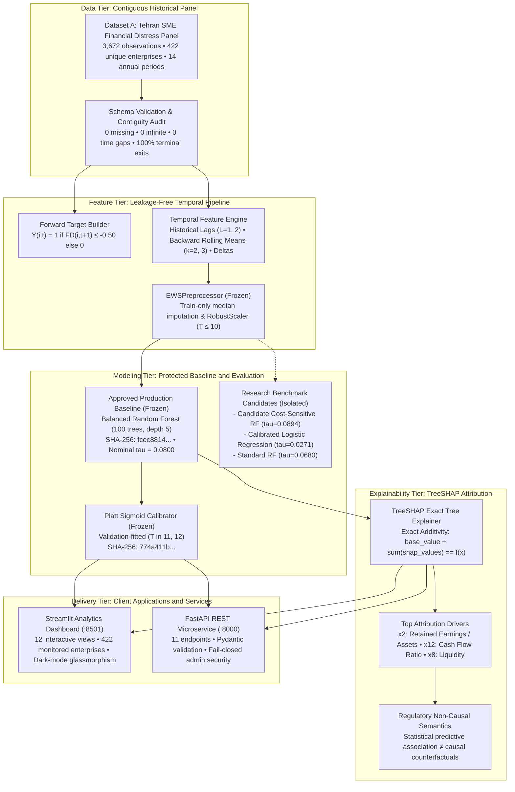
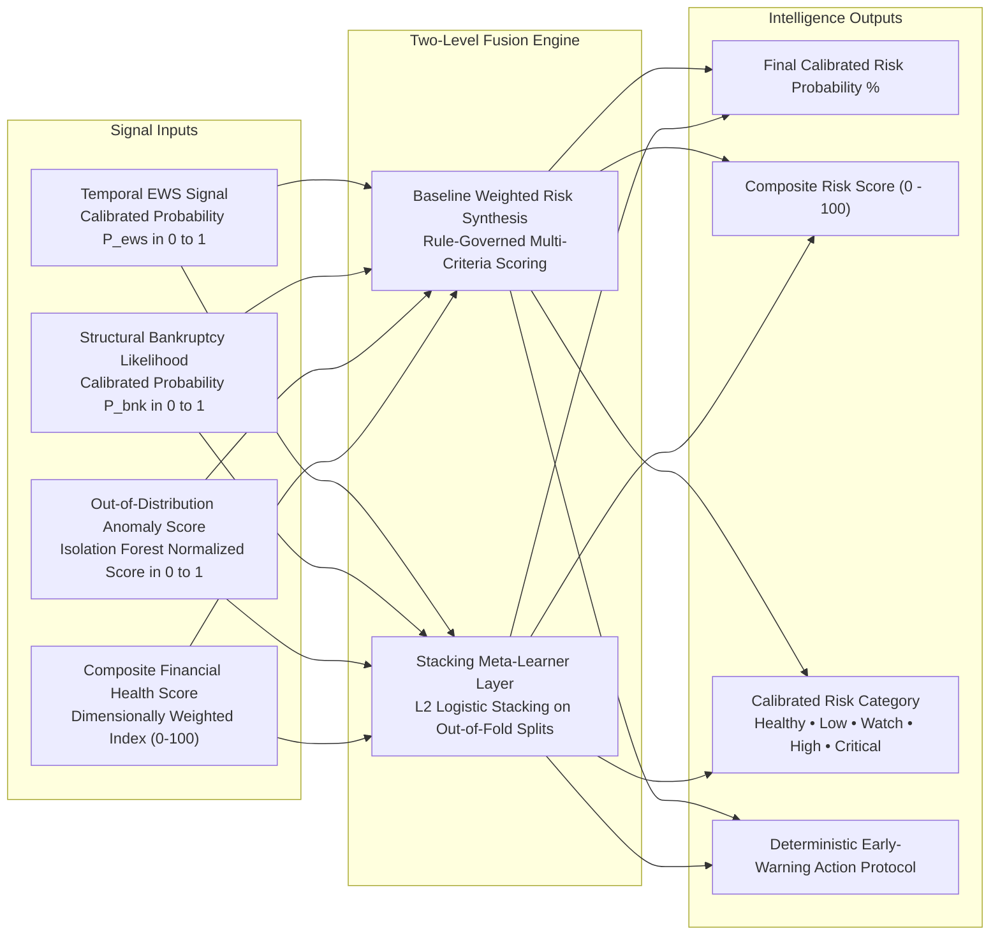
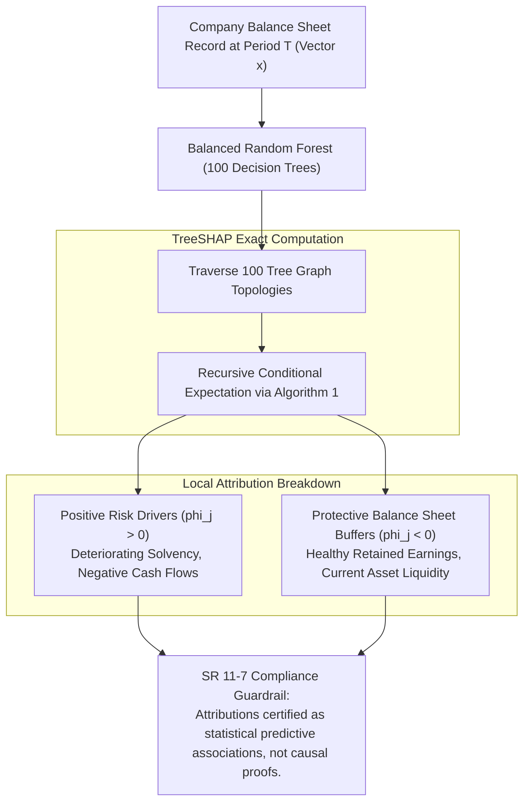
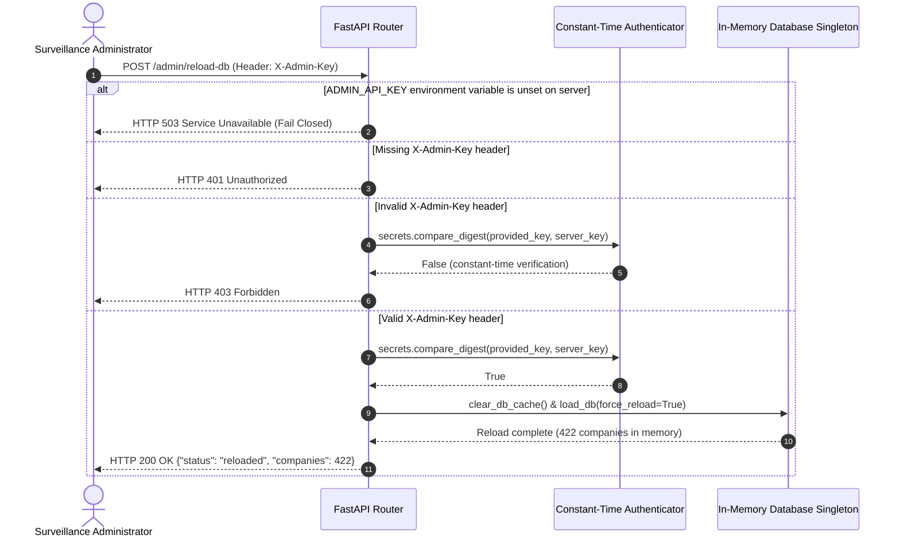

# System Architecture & Technical Specification

**Project:** Explainable Multi-Source SME Financial Distress Early-Warning System  
**Version:** 1.0.0-release  
**Domain:** Computational Corporate Finance, SME Credit Surveillance & Model Risk Governance  
**Governance Standard:** US Federal Reserve SR 11-7 / OCC 2011-12 Supervisory Guidance on Model Risk Management  

---

## 1. High-Level System Architecture

The system is architected as an end-to-end corporate risk intelligence engine. It transforms raw multi-period accounting panels into calibrated, interpretable forward early-warning alerts without lookahead leakage.



---

## 2. Temporal Data Splitting & Leakage Prevention

Temporal leakage occurs when future information contaminates training features or targets. This architecture enforces strict chronological boundaries:

```mermaid
gantt
    title Chronological Panel Partitioning Strategy
    dateFormat X
    axisFormat T=%s
    section Training Split
    Periods 1 to 10 (2,471 evaluable rows, 95 defaults) :active, 1, 10
    section Validation Split
    Periods 11 to 12 (517 evaluable rows, 14 defaults) :crit, 11, 12
    section Holdout Cohort
    Period 13 predicting Period 14 (262 rows, 11 defaults) :done, 13, 13
    section Terminal Exit
    Period 14 Terminal Exit (262 rows, unobserved t+1) :milestone, 14, 14
```



### Mathematical Invariants:
1. **Intra-Firm Forward Labeling:**  
   $$Y_{i, t} = \begin{cases} 1 & \text{if } \text{Company}_{i, t+1} == \text{Company}_{i, t} \text{ and } \text{Financial Distress}_{i, t+1} \le -0.50 \\ 0 & \text{if } \text{Company}_{i, t+1} == \text{Company}_{i, t} \text{ and } \text{Financial Distress}_{i, t+1} > -0.50 \\ \text{NaN} & \text{if } t \text{ is the terminal observed period for company } i \end{cases}$$
2. **Preprocessor Isolation:**  
   $$\mu_{\text{train}}, \sigma_{\text{train}} = \text{fit}(X_{\text{train}} \mid T \le 10)$$
   $$X_{\text{test}}^{\text{scaled}} = \frac{X_{\text{test}} - \mu_{\text{train}}}{\sigma_{\text{train}}}$$
   Parameters are frozen and never updated during test transformation.
3. **Calibrator Isolation:**  
   Platt scaling sigmoid parameters $A, B$ are estimated exclusively on $X_{\text{val}}, Y_{\text{val}}$ ($T \in [11, 12]$) via maximum likelihood. Holdout test labels ($T=13 \to 14$) are strictly withheld.

---

## 3. Two-Level Risk Fusion Pipeline

To prevent synthetic leakage while providing multi-dimensional evidence, the system fuses temporal risk signals with structural ratio health:



---

## 4. TreeSHAP Attribution Architecture

Global and local explainability is powered by Lundberg et al. (Nature Machine Intelligence, 2020) TreeSHAP exact tree attribution:

$$\mathbb{E}[f(X)] + \sum_{j=1}^{M} \phi_j(x) = f(x)$$



---

## 5. Security & Administrative Access Architecture

Administrative operations (e.g., database cache invalidation via `/admin/reload-db`) are secured with a strict fail-closed security boundary:



---

## 6. Directory Structure & Component Mapping

```text
financial-distress-ews/
├── data/
│   ├── raw/
│   │   ├── Financial Distress.csv      # Primary panel (3,672 rows, 422 firms)
│   │   ├── data.csv                    # Cross-sectional bankruptcy panel
│   │   └── bankruptcy_Test_X.csv       # Unlabelled industrial benchmark
│   └── processed/
│       ├── companies_risk_intelligence.json # Pre-warmed 422-firm surveillance cache
│       └── watchlist.csv               # Top-50 priority surveillance watchlist
├── models/
│   └── phase2/                         # Cryptographically protected baseline
│       ├── best_ews_model.joblib       # Approved Random Forest (SHA-256: fcec8814...)
│       ├── ews_calibrator.joblib       # Approved Sigmoid Calibrator (SHA-256: 774a411b...)
│       ├── ews_preprocessor.joblib     # Approved Robust Scaler (SHA-256: 2342eb7f...)
│       └── threshold_config.json       # Production operating threshold (0.0800)
├── src/
│   ├── data/loaders.py                 # Multi-source dataset ingestion & schema validation
│   ├── preprocessing/preprocessors.py  # Leakage-safe EWSPreprocessor & imputer
│   ├── features/temporal_features.py   # Lags, rolling statistics, and forward targets
│   ├── explainability/                 # TreeSHAP explainer & local waterfall generators
│   └── fusion/                         # Stacking meta-learner & composite health index
├── dashboard/                          # Plotly visualization components & dark-mode CSS
├── tests/                              # Automated pytest suite (226 tests)
├── app.py                              # Streamlit 12-page risk analytics dashboard
├── api.py                              # FastAPI 11-endpoint REST microservice
├── Dockerfile                          # Production container specification
├── docker-compose.yml                  # Multi-service dashboard + API compose
├── requirements.txt                    # Pinned Python dependencies
└── README.md                           # Master technical documentation
```
