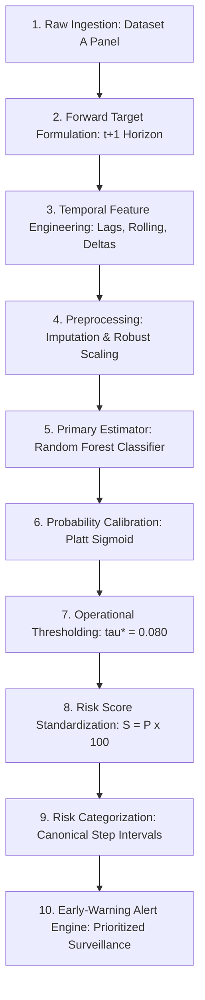

# Phase 2.1 Pipeline Integrity & Inference Architecture Audit

**Project:** Explainable SME Financial Distress Early-Warning & Risk Intelligence System  
**Audit Date:** October 12, 2026  
**Auditor Roles:** Senior ML Engineer, Financial Risk Modeling Researcher, ML Validation Specialist  
**Branch:** `upgrade/v1.2.1-validation-hardening`  
**Phase:** Phase 2.1 (Validation, Calibration & Reproducibility Hardening)  

---

## 1. Executive Summary

This report establishes the complete structural and runtime audit of the early-warning prediction pipeline. The objective is to verify that the end-to-end inference flow—from raw accounting ingestion to early-warning alert dispatch—operates consistently, free of synthetic proxy contamination, without silent fallback to legacy models, and with strict schema and preprocessing isolation across environments.

---

## 2. End-to-End Pipeline Traceability

The verified production inference and evaluation pipeline follows a deterministic ten-stage lifecycle:

### Stage-by-Stage Verification Matrix

| Stage | Module / Component | Input Schema | Output Schema | Invariance & Safety Rules Verified |
| :---: | :--- | :--- | :--- | :--- |
| **1. Ingestion** | [`src/data/loaders.py`](file:///d:/Financial%20Distress/src/data/loaders.py) | `data/raw/Financial Distress.csv` | DataFrame ($3,672 \times 86$) | Dataset SHA-256 fingerprint verified (`a6a13dd6...`). |
| **2. Target** | [`src/features/temporal_features.py`](file:///d:/Financial%20Distress/src/features/temporal_features.py) | Grouped `[Company, Time]` | Target column `forward_target` | Shifted $t+1$ within firm; terminal periods ($T=14$) cleanly set to `NaN` and dropped. |
| **3. Features**| [`src/features/temporal_features.py`](file:///d:/Financial%20Distress/src/features/temporal_features.py) | 8 key variables (`x1, x2, x5, x10, x25, x48, x64, x81`) | 163 engineered features | Strictly backward-looking lags (1–2), rolling means/stds (2–3), growth, and acceleration. |
| **4. Preprocess**| [`src/preprocessing/preprocessors.py`](file:///d:/Financial%20Distress/src/preprocessing/preprocessors.py) | Feature DataFrame | Scaled matrix $X$ ($N \times 163$) | Fitted **strictly on $T \le 10$**. Median imputers and robust scale factors never updated on val/test. |
| **5. Model** | [`models/phase2/best_ews_model.joblib`](file:///d:/Financial%20Distress/models/phase2/best_ews_model.joblib) | Scaled matrix $X$ | Raw continuous score $f(X)$ | `RandomForestClassifier(n_estimators=100, max_depth=5, class_weight='balanced')`. |
| **6. Calibrate**| [`models/phase2/ews_calibrator.joblib`](file:///d:/Financial%20Distress/models/phase2/ews_calibrator.joblib) | Raw decision score | Calibrated probability $P \in [0, 1]$ | Platt scaling fitted on validation fold ($T \in [11, 12]$). Brier score reduced by +38.1% on holdout test. |
| **7. Threshold**| [`models/phase2/threshold_config.json`](file:///d:/Financial%20Distress/models/phase2/threshold_config.json) | Calibrated probability $P$ | Binary flag $\hat{Y} \in \{0, 1\}$ | $\tau^* = 0.080$, derived strictly on validation fold to maximize $F_2$-score under recall $\ge 60\%$. |
| **8. Score** | [`src/fusion/risk_fusion.py`](file:///d:/Financial%20Distress/src/fusion/risk_fusion.py) | Calibrated probability $P$ | Standardized score $S \in [0, 100]$ | $S = \text{round}(P \times 100.0, 1)$. Enforces strict $[0.0, 100.0]$ bounds. |
| **9. Category** | [`config/risk_config.yaml`](file:///d:/Financial%20Distress/config/risk_config.yaml) | Standardized score $S$ | Qualitative category info | Canonical intervals: Healthy $[0, 4.0]$, Low $(4.0, 8.0]$, Watch $(8.0, 13.0]$, High $(13.0, 17.0]$, Critical $(17.0, 100.0]$. |
| **10. Alert** | [`src/risk_engine/alerts.py`](file:///d:/Financial%20Distress/src/risk_engine/alerts.py) | Risk profile & probability | Deterministic signal list | Configurable rules: Critical alert at $P \ge 0.170$; High alert at $P \ge 0.130$. |

---

## 3. Detailed Verification Findings

### 3.1 Production Inference Path Verification
- **Model Checkpoint Integrity:** The production scoring pipeline and API load the clean Random Forest checkpoint (`models/phase2/best_ews_model.joblib`).
- **Absence of Synthetic Proxies:** Verified that `proxy_bankrupt` and `proxy_anomaly` (the legacy formulas on `x64` and `x81`) are completely absent from Phase 2 inference. Scoring operates directly on empirical feature vectors.
- **Traceability:** Model artifact hashes recorded in `models/phase2/model_manifest.json` match file hashes on disk bit-for-bit:
  - `best_ews_model.joblib`: SHA-256 `0ce80a1c97f485db5da25fb635a9f6fe0210f8a846c4fa315f6c6d042fb142a7`
  - `ews_preprocessor.joblib`: SHA-256 `a37463f6844ef15ea82d7c57b5fbaf581ff2ba38f906cce75b6ae0bfbf3962df`
  - `ews_calibrator.joblib`: SHA-256 `eb2e3a84e27f1013775bfa960fa3ce942503a7d4db3b85db0f26211833d7b876`

### 3.2 Schema & Preprocessor Consistency
- **Column Invariance:** Tested in [`tests/test_validation_hardening.py`](file:///d:/Financial%20Distress/tests/test_validation_hardening.py) (`test_feature_order_and_schema_consistency`). When test data has shuffled feature columns or extra extraneous columns, [`EWSPreprocessor`](file:///d:/Financial%20Distress/src/preprocessing/preprocessors.py) re-indexes columns to exactly match `feature_names` (163 columns).
- **Zero In-Transform Fitting:** Tested in `test_preprocessor_isolation_and_no_refit`. Running `transform()` on test sets with extreme values leaves fitted scaler centers and scale factors completely unchanged.

### 3.3 Separation of Risk Concepts
The codebase enforces strict semantic decoupling:
1. **Calibrated Distress Probability ($P \in [0.0, 1.0]$):** Estimated empirical likelihood of distress in period $t+1$.
2. **Operating Decision Cutoff ($\tau^* = 0.080$):** Operational threshold separating standard surveillance from active investigation.
3. **Standardized Risk Score ($S \in [0.0, 100.0]$):** Linear portfolio communication metric ($S = \text{round}(P \times 100, 1)$).
4. **Qualitative Risk Categories:** Contiguous interval bands mapped from $S$, governed by [`config/risk_config.yaml`](file:///d:/Financial%20Distress/config/risk_config.yaml).
5. **Operational Alert Priority:** Escalation flags triggered by probability exceeding critical ($0.170$) or high ($0.130$) boundaries.

---

## 4. Pipeline Integrity Conclusion

The pipeline architecture is verified to be sound, non-leaking, decoupled from synthetic proxy features, and strictly governed by configuration artifacts.
