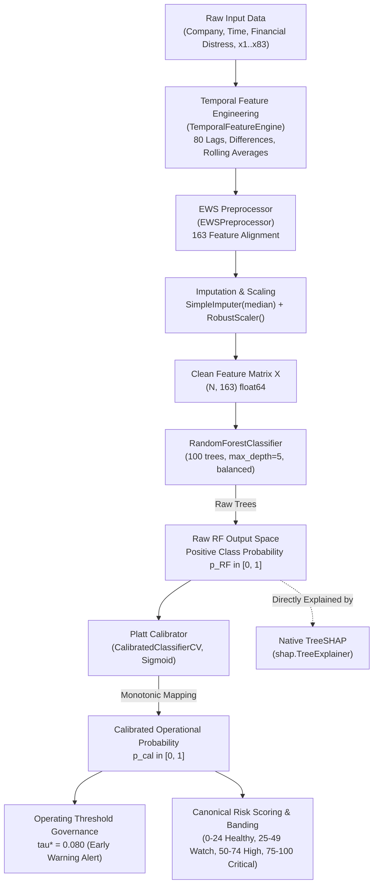

# Phase 3 Audit: Real Prediction & Inference Pipeline Trace

**Project:** Explainable SME Financial Distress Early-Warning & Risk Intelligence System  
**Branch:** `upgrade/v1.3-explainability`  
**Audit Date:** October 12, 2026  
**Auditor Roles:** Senior ML Engineer, Explainable AI Researcher, ML Validation Specialist  

---

## 1. Executive Summary & Purpose

Before implementing model-faithful explainability via native TreeSHAP, the complete inference pipeline must be audited from raw input to final operational alerts. This document details the verified transformation chain, output spaces, class indexing, calibrator mechanics, and the critical distinction between raw estimator outputs and downstream Platt-calibrated operational probabilities.

---

## 2. Verified Transformation Chain

---

## 3. Component-by-Component Traceability

### 3.1 Raw Input Schema
- **Panel Structure:** 422 Iranian SMEs across 14 annual reporting periods (Dataset A).
- **Core Identifiers:** `Company` (firm ID 1..422), `Time` (period index 1..14).
- **Target Column:** `Financial Distress` (continuous index, default event threshold $\le -0.50$).
- **Financial Indicators:** 83 anonymized indicators `x1` through `x83`.

### 3.2 Temporal Feature Construction (`TemporalFeatureEngine`)
- **Location:** [`src/features/temporal_features.py`](file:///d:/Financial%20Distress/src/features/temporal_features.py)
- **Target Construction:** Forward target $y_{i, t} = I(\text{Financial Distress}_{i, t+1} \le -0.50)$ aligned within the same firm. Rows with $T=14$ have undefined next-period targets (`NaN`) and are dropped from model evaluation.
- **Engineered Features:** 10 temporal transformations across 8 key financial variables (`x1`, `x2`, `x5`, `x10`, `x25`, `x48`, `x64`, `x81`):
  1. `_lag_1` (prior period value)
  2. `_lag_2` (two-period prior value)
  3. `_diff_1` (first difference: $x_t - x_{t-1}$)
  4. `_growth_1` (percentage growth: $\frac{x_t - x_{t-1}}{|x_{t-1}| + \epsilon}$)
  5. `_acceleration` (second difference: $\Delta x_t - \Delta x_{t-1}$)
  6. `_roll_mean_2` (2-period backward moving average)
  7. `_roll_mean_3` (3-period backward moving average)
  8. `_roll_std_3` (3-period backward moving standard deviation)
  9. `_consec_decline_2` (indicator of 2 consecutive periods of decline)
  10. `_dev_from_baseline` (deviation from initial observation: $x_t - x_1$)
- **Total Temporal Features:** $8 \times 10 = 80$ features.
- **Total Candidate Features:** $83 \text{ raw} + 80 \text{ temporal} = 163 \text{ features}$.

### 3.3 Preprocessing & Schema Order (`EWSPreprocessor`)
- **Location:** [`src/preprocessing/preprocessors.py`](file:///d:/Financial%20Distress/src/preprocessing/preprocessors.py)
- **Artifact Path:** [`models/phase2/ews_preprocessor.joblib`](file:///d:/Financial%20Distress/models/phase2/ews_preprocessor.joblib)
- **Feature Order:** Deterministically fixed to the 163 columns listed in `models/phase2/model_manifest.json`:
  - Features 0 to 82: `x1` through `x83`
  - Features 83 to 162: `x1_lag_1` through `x81_dev_from_baseline`
- **Missing Value Imputation:** `SimpleImputer(strategy='median')` fitted strictly on training data ($T \le 10$).
- **Feature Scaling:** `RobustScaler(with_centering=True, with_scaling=True)` using median centering and interquartile range (IQR) scaling.
- **Output:** Dense 2D NumPy array of shape `(N, 163)`, dtype `float64`.

### 3.4 Primary Estimator (`RandomForestClassifier`)
- **Artifact Path:** [`models/phase2/best_ews_model.joblib`](file:///d:/Financial%20Distress/models/phase2/best_ews_model.joblib)
- **Estimator Class:** `sklearn.ensemble.RandomForestClassifier`
- **Hyperparameters:**
  - `n_estimators = 100`
  - `max_depth = 5`
  - `class_weight = 'balanced'`
  - `criterion = 'gini'`
  - `max_features = 'sqrt'`
  - `random_state = 42`
  - `n_jobs = -1`
- **Classes:** `model.classes_ = array([0, 1])`
  - Index 0: Non-distressed / Solvent
  - Index 1: Forward Financial Distress (Target = 1)
- **Output Space:** `model.predict_proba(X)` outputs an $(N, 2)$ matrix of tree-averaged probabilities $p_{\text{RF}} \in [0, 1]$.
  - Base expectation for Class 1: $\mathbb{E}[p_{\text{RF}}] \approx 0.4969$ (elevated by balanced class weights during tree construction).

### 3.5 Probability Calibration (`CalibratedClassifierCV`)
- **Artifact Path:** [`models/phase2/ews_calibrator.joblib`](file:///d:/Financial%20Distress/models/phase2/ews_calibrator.joblib)
- **Calibrator Class:** `sklearn.calibration.CalibratedClassifierCV(method='sigmoid', cv='prefit')`
- **Calibration Split:** Fitted strictly on Validation Fold ($T = 11, 12$, $N = 517$).
- **Internal Mechanics:** Platt scaling fits a univariate logistic sigmoid mapping:
  $$p_{\text{cal}} = \frac{1}{1 + \exp(a \cdot p_{\text{RF}} + b)}$$
  Fitted coefficients on validation data:
  $$a \approx -5.5654, \quad b \approx +4.9481$$
- **Effect on Probabilities:** Cures the artificial over-prediction produced by class-weight balancing:
  - If $p_{\text{RF}} = 0.0576$, then $p_{\text{cal}} \approx 0.0097$.
  - If $p_{\text{RF}} = 0.5000$, then $p_{\text{cal}} \approx 0.1030$.
  - If $p_{\text{RF}} = 0.9000$, then $p_{\text{cal}} \approx 0.5152$.

### 3.6 Operating Threshold & Alert Decisions
- **Config Path:** [`models/phase2/threshold_config.json`](file:///d:/Financial%20Distress/models/phase2/threshold_config.json)
- **Operating Alert Threshold:** $\tau^* = 0.080$ (selected to maximize $F_2$-Score on Validation fold subject to Recall $\ge 60\%$).
- **Alert Tiers:**
  - $p_{\text{cal}} < 0.080$: Normal / No Alert
  - $0.080 \le p_{\text{cal}} < 0.130$: Early Warning Alert (Watch)
  - $0.130 \le p_{\text{cal}} < 0.170$: High Alert
  - $p_{\text{cal}} \ge 0.170$: Critical Early Warning Alert

### 3.7 Risk Scoring & Banding Architecture
- **Operational Risk Score:** Canonical composite score on 0 – 100 scale.
- **Risk Bands:**
  - **Low Risk (Healthy):** 0 – 24
  - **Medium Risk (Watch):** 25 – 49
  - **High Risk (High):** 50 – 74
  - **Severe Distress (Critical):** 75 – 100

---

## 4. Critical Explainability Nuance: Output Space Alignment

> [!IMPORTANT]
> ### Raw Random Forest Output Space vs. Platt-Calibrated Probability
> 1. **Native TreeSHAP operates on the tree ensemble directly:**
>    - `shap.TreeExplainer(model)` explains the Random Forest output space ($p_{\text{RF}}$).
>    - In this space, exact additivity holds:
>      $$\sum_{j=1}^{163} \phi_j(\mathbf{x}) + \mathbb{E}[p_{\text{RF}}] = p_{\text{RF}}(\mathbf{x})$$
> 2. **Downstream Platt calibration is non-linear:**
>    - The final operational prediction is $p_{\text{cal}} = \sigma(a \cdot p_{\text{RF}} + b)$.
>    - Because $\sigma(\cdot)$ is non-linear, the sum of raw SHAP values $\sum \phi_j$ **does NOT equal** $p_{\text{cal}} - \mathbb{E}[p_{\text{cal}}]$.
> 3. **Design Requirement:**
>    - Local explanations must explicitly declare their output space as `"raw_random_forest_probability"`.
>    - The system must report both the raw tree probability ($p_{\text{RF}}$) and the operational calibrated probability ($p_{\text{cal}}$).
>    - Feature attributions must not be erroneously added to $p_{\text{cal}}$.

---

## 5. Input Validation & Error Handling Contract

1. **Schema Mismatch:** If an input DataFrame contains missing columns, `EWSPreprocessor` imputes missing features using pre-computed training medians.
2. **Missing Company / Period:** If an API request specifies a non-existent `company_id` or `period`, the service returns HTTP 404 with a structured error payload.
3. **Invalid Parameter Bounds:** `top_n` must be an integer between 1 and 163. Invalid inputs return HTTP 422.
4. **No-Refit Invariance:** All explanation services load pre-trained artifacts as read-only objects. No model fitting, preprocessor fitting, or threshold adjustment occurs during inference or explanation.
