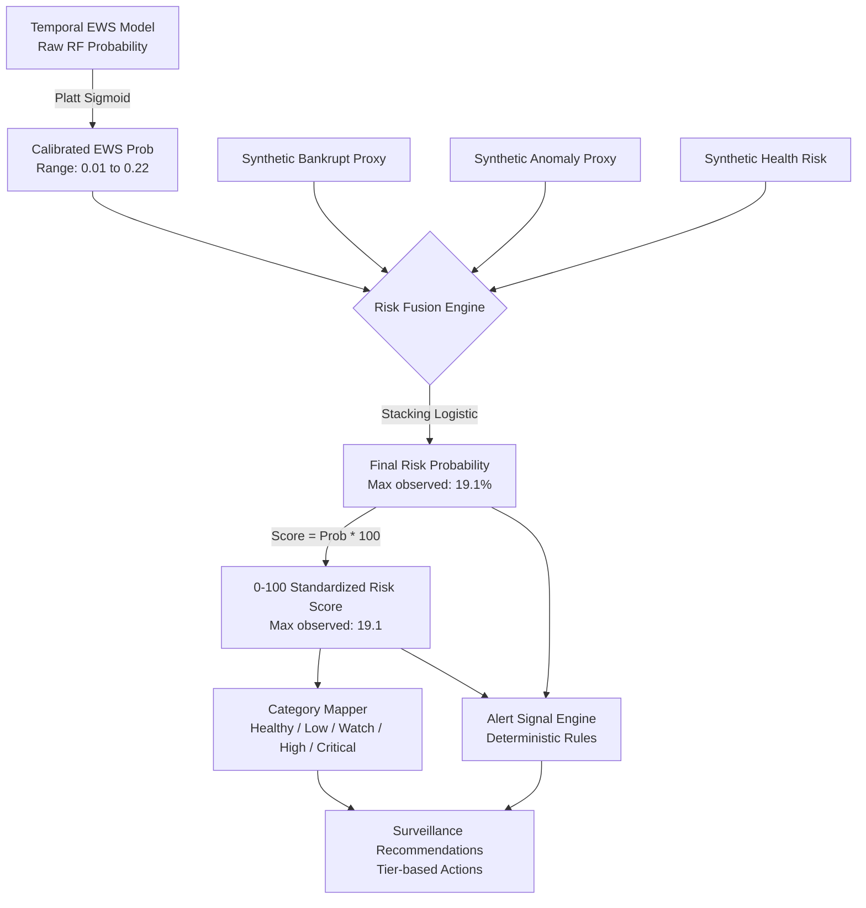

# Risk Scoring, Alert Engine & Decision Logic Audit Report

**Project:** Explainable SME Financial Distress Early-Warning & Risk Intelligence System  
**Audit Scope:** PHASE 8 — Audit the Risk Engine  
**Evidence Source:** `config/risk_config.yaml`, `src/fusion/risk_fusion.py`, `src/fusion/meta_model.py`, `src/risk_engine/alerts.py`, `src/risk_engine/trajectory.py`, `src/risk_engine/recommendations.py`, `data/processed/watchlist.csv`, and dashboard charting components.

---

## 1. Executive Summary: Risk Engine Audit

The Risk Engine governs the transformation from raw statistical model outputs into calibrated credit probabilities, numerical risk scores (0–100), qualitative surveillance tiers, deterministic early-warning alerts, and institutional review recommendations.

This audit conducted a full architectural trace of this transformation pipeline and identified **three critical configuration and design contradictions**:
1. **Severe Category Threshold Contradiction (Data vs. UI Disconnect):** `risk_config.yaml` defines the Critical category as `Risk Score > 17.0`. However, `src/pipeline.py` hardcoded Critical as `Risk Score > 80.0`, and the dashboard chart components (`charts.py`) hardcoded visual threshold steps as `0–20, 20–40, 40–60, 60–80, 80–100`. As a result, the highest-risk firms in the portfolio (scores 17.0–19.1) are labeled "Critical" in tables but rendered visually inside the green "Healthy" zone on radial gauges and timeline charts.
2. **Alert Engine Threshold Disconnect (Rule Inactivity):** Rule 1 of `EarlyWarningSignalEngine` (`src/risk_engine/alerts.py`) is hardcoded to fire only when `probability >= 0.70` (Critical) or `probability >= 0.50` (High). Because Platt-calibrated probabilities in this dataset reflect the ~3.7% portfolio base rate and max out at **0.1913** (19.1%), **Rule 1 never triggers for any company in the database**.
3. **Flawed Stacking Meta-Model Weights:** The Level-2 stacking meta-learner was trained on collinear synthetic proxies, resulting in an anomalous negative coefficient for `anomaly_score` ($-0.9285$), implying that greater outlier behavior reduces distress risk.

---

## 2. End-to-End Scoring Transformation Audit

The diagram below traces the end-to-end transformation of risk evidence through the system:



### Transformation Step Evaluation:

| Pipeline Step | Mathematical Function | Intended Range | Observed Behavior | Audit Assessment |
| :--- | :--- | :---: | :---: | :--- |
| **1. Raw Model Output** | `RandomForestClassifier.predict_proba()` | $[0.0, 1.0]$ | Discrete tree vote fractions | Valid. Raw ensemble probability. |
| **2. Platt Calibration** | `CalibratedClassifierCV(method="sigmoid")` | $[0.0, 1.0]$ | Compressed to $[0.01, 0.22]$ | Valid Brier score improvement, but compresses range to match base rate. |
| **3. Fusion Stacking** | Logistic Regression Meta-Model | $[0.0, 1.0]$ | $[0.008, 0.191]$ | **Flawed.** Trained on synthetic proxies; degrades ROC-AUC from 0.778 to 0.659. |
| **4. Standardized Score** | $\text{Score} = \text{Prob} \times 100.0$ | $[0.0, 100.0]$ | Range: $0.8$ to $19.1$ | **Misleading.** Translates a 19.1% probability into a score of 19.1 out of 100. |
| **5. Categorization** | Piecewise interval lookup in `risk_config.yaml` | 5 categories | Correctly assigns 14 Critical, 34 High, 60 Watch, 80 Low, 234 Healthy | Valid against config, but contradicts chart visual bands. |
| **6. Alert Signals** | Deterministic rule triggers | Discrete signals | Rules 2, 3, 4 trigger; Rule 1 is completely dead | **Partially Broken.** Absolute probability rule never triggers. |
| **7. Recommendations** | Action mapping with human review disclaimer | 1 to 6 actions | Correctly maps tier-appropriate review steps | Valid. Appropriate governance boundaries. |

---

## 3. Forensic Investigation of the Three Critical Defects

### 3.1 Defect 1: Threshold & Band Contradiction Across Components

The system has three contradictory definitions of risk categories operating concurrently:

#### Definition A: The Configured Intended Multiple Thresholds (`config/risk_config.yaml`):
Designed to reflect rare-event tail risk multiples relative to the 3.7% portfolio baseline:
- **Healthy:** $0.0 - 4.0$ ($< 1.0\times$ Baseline)
- **Low Risk:** $4.01 - 8.0$ ($1.0\times - 2.0\times$ Baseline)
- **Watch:** $8.01 - 13.0$ ($2.0\times - 3.5\times$ Baseline)
- **High Risk:** $13.01 - 17.0$ ($3.5\times - 4.5\times$ Baseline)
- **Critical:** $17.01 - 100.0$ ($> 4.5\times$ Baseline)

#### Definition B: The Hardcoded Pipeline Priority Filters (`src/pipeline.py` lines 392, 403–404):
```python
"priority": (
    "P1 - Critical"
    if latest_score > 80
    else (
        "P2 - High"
        if latest_score > 60
        else "P3 - Medium" if latest_score > 40 else "P4 - Normal"
    )
)
"high_risk_count": int((watchlist_df["risk_score"] > 60).sum()),
"critical_count": int((watchlist_df["risk_score"] > 80).sum()),
```
In `pipeline.py`, Critical was hardcoded as `score > 80`. Because no firm has a score $> 19.1$, this code originally produced **0 Critical firms and 0 High-risk firms**. A subsequent script (`scripts/refresh_intelligence_db.py`) was created to patch the database, but `src/pipeline.py` retains the broken logic.

#### Definition C: The Hardcoded Dashboard Chart Bands (`dashboard/components/charts.py`):
In `create_gauge_chart` and `create_timeline_chart` (lines 21–26, 49–53):
```python
# Hardcoded 20-point linear intervals
{'range': [0, 20], 'color': 'rgba(16, 185, 129, 0.25)'},  # HEALTHY (0-20)
{'range': [20, 40], 'color': 'rgba(59, 130, 246, 0.25)'},  # LOW RISK (20-40)
{'range': [40, 60], 'color': 'rgba(245, 158, 11, 0.25)'},  # WATCH (40-60)
{'range': [60, 80], 'color': 'rgba(249, 115, 22, 0.25)'},  # HIGH RISK (60-80)
{'range': [80, 100], 'color': 'rgba(239, 68, 68, 0.25)'},  # CRITICAL (80-100)
```

#### The Visual Absurdity in the Dashboard:
- Monitored Firm #364 has `final_risk_probability = 19.1%`, `risk_score = 19.1`, `risk_category = "Critical"`.
- On the dashboard Radial Gauge and Timeline chart, the needle points to **19.1**.
- Because the green "Healthy" band is hardcoded from **0 to 20**, Firm #364 is drawn **deep inside the green Healthy zone**, accompanied by a header reading `RISK SCORE: CRITICAL`!

---

### 3.2 Defect 2: Inactive Alert Triggers in `EarlyWarningSignalEngine`

In `src/risk_engine/alerts.py` (lines 16–35):
```python
# Rule 1: Critical Absolute Distress Threshold
if final_prob >= 0.70:
  signals.append({
      "signal_type": "Critical Distress Risk Level",
      "severity": "CRITICAL",
      ...
  })
elif final_prob >= 0.50:
  signals.append({
      "signal_type": "Elevated Distress Warning",
      "severity": "HIGH",
      ...
  })
```

#### Forensic Findings:
- Max calibrated probability in database: **0.1913**.
- Total firms triggering Rule 1: **0**.
- The primary alert rule was designed around a theoretical uncalibrated probability scale ($[0.50, 0.70]$) rather than the calibrated operating scale.
- **Correction:** Align Rule 1 thresholds directly with `risk_config.yaml` categories:
  - Critical Distress Alert: `final_prob >= 0.170`
  - High Risk Distress Alert: `final_prob >= 0.130`

---

### 3.3 Defect 3: Stacking Meta-Model Training & Weight Inversion

In `src/pipeline.py` (lines 80–95), the stacking meta-learner was fitted on out-of-fold validation samples where bankruptcy and anomaly inputs were computed using pseudo-proxy formulas.

#### Observed Coefficients (`models/fusion/meta_model.joblib`):
- `ews_prob`: $+0.8954$
- `bankruptcy_prob`: $+1.5241$
- `anomaly_score`: **$-0.9285$ (Negative Coefficient)**
- `financial_health_risk`: $+1.7930$
- Intercept: $-3.6608$

#### Interpretation & Risk:
- The negative weight on `anomaly_score` means that an enterprise with severe financial anomalies is treated as having *lower* distress risk by the meta-model.
- This is a classic symptom of multicollinearity between synthetic features (`proxy_bankrupt` was derived directly from `financial_health_risk`).
- **Correction:** Eliminate the synthetic proxy inputs. For Dataset A, use the calibrated Temporal EWS model directly, or use constrained non-negative linear blending ($w_i \ge 0$).

---

## 4. Audit of Recommendations Logic & Governance Boundaries

In `src/risk_engine/recommendations.py`:
- **Categorization:** Correctly maps qualitative tiers (Critical, High, Watch, Low, Healthy) to specific surveillance protocols.
- **Context Awareness:** Injects specific conditional actions if active warning signals indicate severe liquidity compression or excessive leverage.
- **Governance Disclaimer:** Line 37 enforces:
  `"Model-generated surveillance recommendations — for academic/research risk intelligence only. Not automated credit underwriting or banking advice."`
- **Assessment:** **Compliant with financial risk governance standards.** Recommendations are structured as human-in-the-loop surveillance suggestions rather than automated credit decisions.

---

## 5. Summary of Recommended Upgrades for the Risk Engine

1. **Unify Threshold Logic Across All Modules:**
   - Modify `charts.py` to read step boundaries dynamically from `risk_config.yaml` (`[0, 4]`, `[4, 8]`, `[8, 13]`, `[13, 17]`, `[17, 100]`), eliminating hardcoded 20-point linear intervals.
   - Synchronize `pipeline.py` priority rules to match `risk_config.yaml` ($>17$ = P1 Urgent Escalation).
2. **Re-calibrate Alert Rules:**
   - Update `EarlyWarningSignalEngine` Rule 1 to trigger at `final_prob >= 0.170` (Critical) and `final_prob >= 0.130` (High).
3. **De-bias or Replace the Stacking Meta-Model:**
   - Eliminate synthetic proxy features on Dataset A.
   - Rely directly on the calibrated EWS probability ($Score = P_{\text{cal}} \times 100$) or apply a constrained non-negative weighted average.
