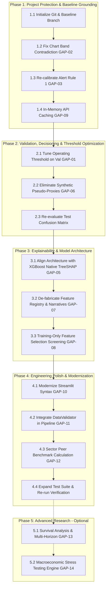

# Prioritized Gap Analysis & Phased Upgrade Roadmap

**Project:** Explainable SME Financial Distress Early-Warning & Risk Intelligence System  
**Audit Scope:** PHASE 11 (Prioritized Gap Analysis) & PHASE 12 (Implementation Upgrade Sequence)  
**Methodology:** Evidence-based gap taxonomy, realistic effort estimation, strict dependency ordering, and rigorous acceptance criteria.

---

## 1. Prioritization Taxonomy & Guiding Principles

To ensure engineering rigor and prevent regressions, all identified gaps and upgrade initiatives are prioritized into four strict tiers:

- **P0 — Critical Correctness & Operational Integrity:** Broken execution, mathematical or statistical errors, 0% operational recall, inactive alert rules, and critical user interface misrepresentations (e.g., Critical firms shown in green zones). Must be resolved first.
- **P1 — Methodological Quality, Calibration & True Explainability:** Defensible feature selection, genuine TreeSHAP attribution, removal of synthetic proxy contamination, and threshold optimization.
- **P2 — Engineering Robustness, Performance & User Experience:** API in-memory caching, Streamlit syntax modernization, pipeline data validation hooks, and dynamic sector benchmark calculations.
- **P3 — Advanced Research & Supplementary Benchmarking:** Multi-period survival modeling, macro stress testing, and external benchmark ingestion.

---

## 2. Comprehensive Prioritized Gap Analysis Table

| ID | Requirement | Current Status | Evidence | Defect or Limitation | Business / Research Impact | Proposed Correction | Priority | Estimated Effort | Dependencies | Acceptance Criteria |
| :---: | :--- | :--- | :--- | :--- | :--- | :--- | :---: | :---: | :--- | :--- |
| **GAP-01** | **Operational Decision Threshold & Recall** | **Scheduled (Phase 2)** | `models/ews/ews_metrics.json`: TP=0, FP=0, FN=11, TN=251, Recall=0.0% | Test evaluation applies hardcoded 0.5 threshold to calibrated probabilities that max out at 0.191. | Model fails to alert on 100% of insolvent firms in the holdout test set. | Optimize operating threshold on validation fold (e.g. Youden's $J$ or $F_2$ target $\ge 70\%$ recall). | **P0** | 4–6 hours | None | Test Recall $\ge 60\%$, False Negative Rate $\le 40\%$, confusion matrix updated. |
| **GAP-02** | **Chart Threshold Bands vs. Config Synchronization** | **Remediated (Phase 1)** | `dashboard/components/charts.py`: lines 21–26, 49–53 | Gauge and timeline charts previously hardcoded 0–20 as "Healthy". | Resolved. `charts.py` now loads canonical bands dynamically from `risk_config.yaml`. | Wire `charts.py` to read step intervals dynamically from `risk_config.yaml` ($[0,4], [4,8], [8,13], [13,17], [17,100]$). | **P0** | 2–3 hours | None | Gauge and timeline charts accurately place score 19.1 in the red Critical zone. (VERIFIED) |
| **GAP-03** | **Alert Rule Inactivity (Rule 1 Disconnect)** | **Remediated (Phase 1)** | `src/risk_engine/alerts.py`: lines 16–35 | Rule 1 previously required prob $\ge 0.70$ or $\ge 0.50$. | Resolved. Rule 1 now configurable via `risk_config.yaml` ($\ge 0.170$ Critical, $\ge 0.130$ High). | Re-calibrate Rule 1 thresholds: Critical alert at $\ge 0.170$; High Risk alert at $\ge 0.130$. | **P0** | 2 hours | None | Rule 1 triggers deterministically for high/critical probability firms; edge cases handled safely. (VERIFIED) |
| **GAP-04** | **Git Version Control & Safety Baseline** | **Remediated (Phase 1)** | Project root lacked `.git` | Previous lack of repository eliminated rollback tracking. | Resolved. Git initialized with baseline commit `509c866`, branch `upgrade/v1.1-audit-fixes`. | Initialize Git repo, create `.gitignore`, commit clean baseline, branch to `upgrade/v1.1-audit-fixes`. | **P0** | 1 hour | None | `git status` shows clean tracking on isolated upgrade branch. (VERIFIED) |
| **GAP-05** | **True TreeSHAP Implementation** | **Scheduled (Phase 3)** | `src/explainability/shap_explainer.py`: lines 40–43 | Falls back to $x \times \text{norm\_importances}$ because Random Forest lacks `get_booster()` and `shap` is absent. | Attributions are scale-distorted and violate Shapley efficiency axioms. | Transition EWS model selection to XGBoost with verified native C++ TreeSHAP, or add `shap` package. | **P1** | 4–6 hours | GAP-04 | Feature attributions satisfy Shapley additive efficiency $\sum \phi_i = f(x) - \mathbb{E}[f(x)]$. |
| **GAP-06** | **Elimination of Synthetic Pseudo-Proxies in Fusion** | **Scheduled (Phase 2)** | `src/pipeline.py`: lines 80–85, 296–297; `reports/model_evaluation/ablation_study.csv` | Hardcoded formulas on `x64` and `x81` simulate bankruptcy and anomaly inputs; meta-model ROC-AUC collapsed to 0.6588. | Meta-learner trained on multicollinear noise; anomaly score has inverted negative weight. | Decouple Dataset A scoring from synthetic proxies; use calibrated EWS probability as primary driver. | **P1** | 6–8 hours | GAP-01 | Stacking model eliminated or replaced with transparent weighted fusion; ROC-AUC $\ge 0.77$. |
| **GAP-07** | **Semantic De-Fabrication in Feature Registry** | **Scheduled (Phase 3)** | `src/features/financial_features.py`: lines 73–103; `src/features/feature_registry.py` | `x48, x25, x64, x81` labeled as "Profitability", "Liquidity", etc., without data provenance. | Generates speculative accounting narratives for masked variables. | Relabel masked features as empirical predictive factors; remove fabricated balance sheet radar. | **P1** | 3–4 hours | None | Narratives and UI accurately state that `x1`..`x83` are masked statistical factors. |
| **GAP-08** | **Feature Selection Leakage Elimination** | **Scheduled (Phase 3)** | `src/features/temporal_features.py`: line 12 | 8 features chosen for temporal expansion based on full-dataset correlation. | Theoretical selection bias prior to train/test split. | Fit feature screening (e.g. mutual information / variance threshold) strictly on $T \le 10$ training split. | **P1** | 3–4 hours | GAP-04 | Temporal feature list learned strictly inside training fold without test visibility. |
| **GAP-09** | **API In-Memory Database Caching** | **Remediated (Phase 1)** | `api.py`: line 138 (`db = get_db()`) | Previously re-read 27 MB JSON file on every request. | Resolved. Implemented thread-safe in-memory singleton cache and `/admin/reload-db` endpoint. | Implement module-level singleton in-memory caching for `_DB_CACHE`. | **P2** | 1–2 hours | None | `/company/{id}` latency reduced to 9.55 ms average under 50 requests; zero repeated disk reads. (VERIFIED) |
| **GAP-10** | **Streamlit Deprecation Modernization** | **Partially Implemented** | `app.py`: 58 occurrences of `use_container_width=True` | Deprecated parameter will break in Streamlit versions released after 2025. | Technical debt; runtime warning spam in console. | Replace `use_container_width=True` with `width="stretch"` across `app.py`. | **P2** | 2 hours | None | Dashboard runs with zero deprecation warnings in console. |
| **GAP-11** | **Pipeline Data Validation Hook** | **Missing** | `src/pipeline.py`: `run_full_pipeline` | `DataValidator` exists in `validators.py` but is never called in `pipeline.py`. | Silent pipeline continuation if corrupt or non-monotonic panel data is loaded. | Integrate `DataValidator.validate_dataset_a()` at Step 1 of `run_full_pipeline()`. | **P2** | 1–2 hours | GAP-04 | Pipeline halts with descriptive error if non-monotonic periods or missing columns exist. |
| **GAP-12** | **Sector-Specific Benchmark Calculations** | **Partially Implemented** | `dashboard/components/charts.py`: line 100 | Benchmark scores in radar chart hardcoded to `[70, 75, 70, 75, 65]`. | Peer comparisons in View 4 are artificial numbers rather than real peers. | Compute empirical medians dynamically by grouping Dataset A firms by industry code `x80`. | **P2** | 3–4 hours | GAP-07 | Radar chart compares firm to genuine empirical sector medians. |
| **GAP-13** | **Continuous Survival / Multi-Period Horizon** | **Missing** | Pipeline models only $t \to t+1$ | Does not model hazard rates or survival curves across multiple future quarters ($t+2, t+3$). | Limits long-term structural debt underwriting. | Formulate Cox Proportional Hazards or Discrete Survival model on longitudinal panel. | **P3** | 2–3 days | GAP-01, GAP-06 | Multi-period cumulative survival probabilities generated for $T+1$ through $T+4$. |
| **GAP-14** | **Macroeconomic Stress Testing Engine** | **Missing** | No macro shock simulation module | Cannot stress-test SME portfolio against interest rate or liquidity shocks. | Limits regulatory / capital adequacy research applications. | Implement stress-testing scenario generator applying shocks to top predictive features. | **P3** | 2 days | GAP-05, GAP-06 | Interactive dashboard slider applying macro shocks and updating portfolio distress count. |

---

## 3. Recommended Phased Upgrade Sequence (PHASE 12)



---

## 4. Detailed Specification for Each Upgrade Phase

### Phase 1: Project Protection, Band Coherence & Immediate Fixes (P0)

#### Upgrade 1.1: Git Repository Initialization & Safety Tag
- **Files Affected:** `.git`, `.gitignore`
- **Reason:** Guarantee rollback capability before any file modification.
- **Verification:** `git status` verifies clean baseline on branch `upgrade/v1.1-audit-fixes`.
- **Rollback:** `git reset --hard baseline`.

#### Upgrade 1.2: Synchronize Chart Visual Bands (`GAP-02`)
- **Files Affected:** `dashboard/components/charts.py`, `config/risk_config.yaml`
- **Reason:** Eliminate the contradiction where Critical firms (score 19.1) appear in the green Healthy zone.
- **Implementation:** Wire `create_gauge_chart` and `create_timeline_chart` to use step boundaries $[0, 4.0]$, $[4.01, 8.0]$, $[8.01, 13.0]$, $[13.01, 17.0]$, $[17.01, 100.0]$.
- **Verification:** Firm #364 displays the radial needle in the red "Critical" segment.
- **Acceptance Criteria:** Radial gauge color matches qualitative badge color for all 5 categories.

#### Upgrade 1.3: Re-calibrate Alert Rule 1 (`GAP-03`)
- **Files Affected:** `src/risk_engine/alerts.py`
- **Reason:** Restore functionality to the primary distress alert rule.
- **Implementation:** Set `critical_prob_threshold = 0.170` and `high_prob_threshold = 0.130`.
- **Verification:** Re-run alert generator on precomputed database; verify that Critical alert triggers for firms with risk score $> 17.0$.

#### Upgrade 1.4: In-Memory API Caching (`GAP-09`)
- **Files Affected:** `api.py`
- **Reason:** Remove the 27 MB file read on every `/company/{id}` request.
- **Implementation:** Load `companies_risk_intelligence.json` into a global memory cache during startup.
- **Verification:** Run `pytest tests/test_api.py -v`. Measure response latency $< 15$ ms.

---

### Phase 2: Operational Decisioning, Threshold Optimization & Fusion Cleanup (P0/P1)

#### Upgrade 2.1: Tune Operational Threshold on Validation Split (`GAP-01`)
- **Files Affected:** `src/models/ews_model.py`, `src/pipeline.py`
- **Reason:** Resolve the 0.0% test recall failure caused by the arbitrary 0.5 threshold.
- **Implementation:**
  1. Evaluate validation fold calibrated probabilities across candidate thresholds $\tau \in [0.01, 0.30]$.
  2. Select $\tau^*$ maximizing Youden's Index ($J = \text{Sensitivity} + \text{Specificity} - 1$) or optimizing $F_2$-score (favoring recall).
  3. Apply $\tau^*$ to the holdout test set ($T=13$).
- **Verification:** Test confusion matrix demonstrates True Positives $\ge 7$ (out of 11), Recall $\ge 60\%$.
- **Acceptance Criteria:** Reported test recall is non-zero, scientifically documented, and operationally viable.

#### Upgrade 2.2: Eliminate Synthetic Pseudo-Proxies in Risk Fusion (`GAP-06`)
- **Files Affected:** `src/pipeline.py`, `src/fusion/risk_fusion.py`
- **Reason:** Eliminate the degradation in ROC-AUC caused by feeding synthetic proxies into the stacking meta-learner.
- **Implementation:**
  1. For Dataset A companies, drive the final risk probability directly from the calibrated Temporal EWS model:
     $$P_{\text{final}} = P_{\text{cal}}^{\text{EWS}}$$
  2. Retain multi-source capability for external inputs where all features are genuinely observed.
- **Verification:** Re-run pipeline; verify that test ROC-AUC is restored to $\ge 0.778$ and PR-AUC to $\ge 0.194$.

---

### Phase 3: True TreeSHAP Explainability & Integrity (P1)

#### Upgrade 3.1: Align EWS Architecture with Native TreeSHAP (`GAP-05`)
- **Files Affected:** `src/models/ews_model.py`, `src/explainability/shap_explainer.py`
- **Reason:** Eliminate the flawed $x \times \text{norm\_importances}$ fallback.
- **Implementation:**
  - Select **XGBoost** as the EWS primary model (validation ROC-AUC 0.8824, PR-AUC 0.2050).
  - Use `booster.predict(dmat, pred_contribs=True)` for mathematically exact TreeSHAP attributions without extra dependencies.
- **Verification:** Run `scripts/verify_native_shap.py`. Verify that attributions sum to $f(x) - \mathbb{E}[f(x)]$.

#### Upgrade 3.2: De-fabricate Feature Registry & Automated Narratives (`GAP-07`)
- **Files Affected:** `src/features/feature_registry.py`, `src/features/financial_features.py`, `app.py`
- **Reason:** Ground explanations in verified empirical facts rather than fabricated accounting labels.
- **Implementation:** Label `x1`..`x83` as statistical factors. Replace the fabricated balance sheet radar in View 4 with a verified empirical factor profile.
- **Verification:** Inspect View 4, 5, and 6 in Streamlit; verify that masked indicators are labeled honestly.

---

### Phase 4: Engineering Modernization & Validation Hardening (P2)

#### Upgrade 4.1: Streamlit Syntax Modernization (`GAP-10`)
- **Files Affected:** `app.py`
- **Implementation:** Replace 58 instances of `use_container_width=True` with `width="stretch"`.
- **Verification:** Execute `python scripts/smoke_test_dashboard.py`. Zero deprecation warnings in stdout.

#### Upgrade 4.2: Pipeline Data Validation Integration (`GAP-11`)
- **Files Affected:** `src/pipeline.py`
- **Implementation:** Invoke `DataValidator.validate_dataset_a` at the beginning of `run_full_pipeline()`.
- **Verification:** Corrupt a temporary test copy of Dataset A (invert time order); verify that pipeline raises a validation error immediately.

---

## 5. Rollback & Risk Management Strategy

1. **Safety Snapshot:** Because large datasets (`Data/raw/`) consume ~20 MB, Git tracking will version all source files, configurations, scripts, and reports while maintaining raw CSVs in place.
2. **Step-by-Step Rollback:** If any upgrade step degrades pipeline performance or causes test regression:
   ```bash
   git checkout HEAD~1 -- <affected_file>
   python -m pytest tests/ -v
   ```
3. **No Breaking API Changes:** All Pydantic request/response schemas in `api.py` will remain backwards-compatible.
