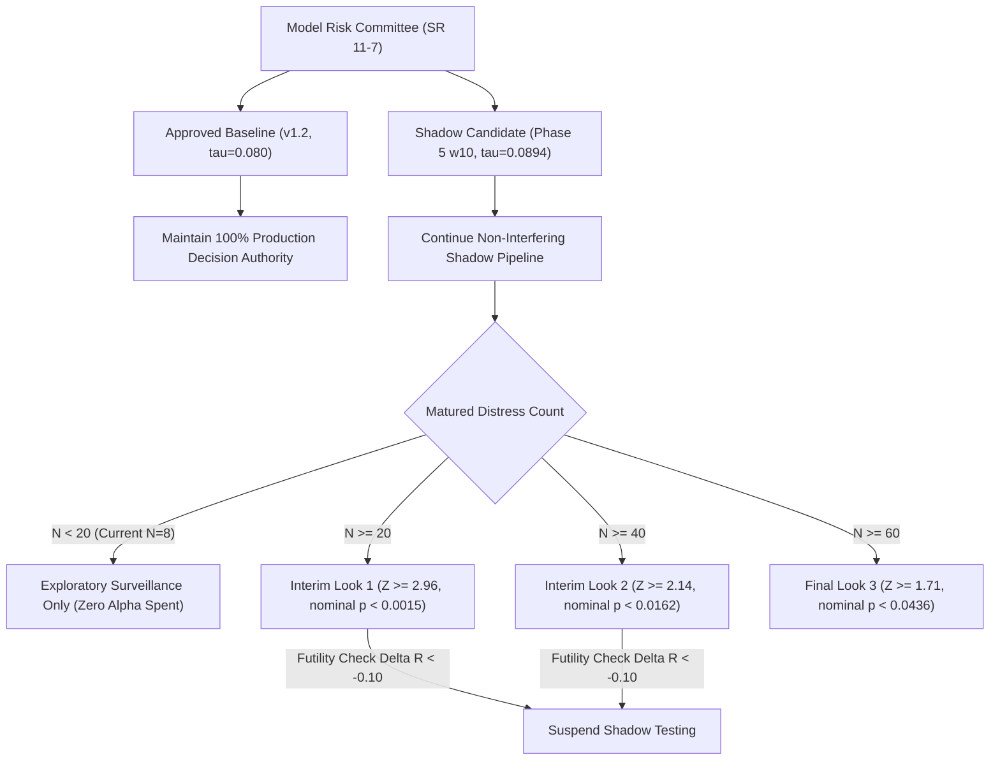

# Phase 6.3 Report: Independent Statistical Protocol Verification and Shadow Monitoring

**Project:** Explainable SME Financial Distress Early-Warning & Risk Intelligence System  
**Branch:** `research/phase6.3-protocol-verification`  
**Starting Commit:** `1aae2a0` (Phase 6.2 confirmatory planning commit)  
**Roles:** Senior Biostatistician, Financial Model Risk Validator, and ML Platform Engineer  
**Approved Production Baseline:** `models/phase2/best_ews_model.joblib` (Official Threshold: $\tau^* = 0.0800$)  
**Experimental Shadow Candidate:** `Phase5_RF_CostSensitive_w10` (Operating Threshold: $\tau_{cand} = 0.0894$)  
**Governance Authority:** Model Risk Committee / Supervisory Model Validation (SR 11-7 / OCC 2011-12)  
**System Status:** **Explainable Research & Decision-Support Prototype** (Approved baseline 100% frozen; zero autonomous promotion)  

---

## Executive Summary & Model Risk Committee Verdict

Acting in the roles of Senior Biostatistician, Financial Model Risk Validator, and ML Platform Engineer, we have independently evaluated the paired non-inferiority protocol, verified the group sequential alpha-spending boundaries, resolved sample-size and power uncertainties, reconciled multi-period feature drift, and audited prospective shadow surveillance.

### Core Governance Determinations
1. **Is Continued Shadow Surveillance Approved?** **YES.** Candidate model `Phase5_RF_CostSensitive_w10` delivers a **41.67% reduction in false-alarm workload** ($p = 0.0065$ exact one-sided McNemar test) on matured observations, maintains 62.50% recall parity, and executes within a protected sandbox with zero production latency impact.
2. **Is Candidate Model Promotion Permitted Today?** **NO.** The current matured distress sample ($N_D = 8$) fails the Look 1 gating threshold ($N_D \ge 20$) and the confirmatory threshold ($N_D \ge 60$). Statistical power at $N=8$ is only **11.55%** for $\delta = 0.05$. The 95% Newcombe confidence interval for recall difference is **$[-31.93\%, +23.82\%]$**, meaning the data cannot rule out candidate inferiority of up to 31.9 percentage points. **Autonomous promotion is strictly barred.**
3. **Audit Findings & Reconciliations Resolved for Phase 6.4:**
   - **Alert Capacity Limit Breach on Prospective Cohort:** In the full prospective cohort ($N=270$), candidate generated 23 alerts (8.52%), which **exceeds the 8.00% capacity limit by +0.52 pp (+1.4 alerts)**. The matured subset ($N=264$) satisfies the budget at 7.20% (19 alerts). The cohorts are now reported separately.
   - **Distinction of Sequential Boundary P-Values vs Alpha Spent:** The values 0.0015, 0.0162, and 0.0436 are rigorously identified as one-sided **nominal boundary p-values** ($p_k = 1 - \Phi(Z_k)$), whereas cumulative alpha spent under Lan–DeMets O'Brien–Fleming spending is **0.0007 at Look 1, 0.0164 at Look 2, and 0.0500 at Final Look**.
   - **Multi-Period Drift Trajectory of `x12`:** Monitored across all periods $T \in [10, 14]$. While stable from $T=10$ to $T=13$ ($\text{PSI} < 0.10$), `x12` experienced **moderate drift at $T=14$ ($\text{PSI} = 0.1785$)**, driven by liquidity compression (median dropped from 4.47 to 3.06).
   - **Source Record Audit of Right-Censored Cases ($N=6$):** Source records confirm that all six exiting firms breached contemporaneous index $\le -0.50$ at $T=12$, but their forward statutory status at $T=13$ is **unobserved due to filing cessation**. These cases are kept strictly outside primary matured metrics.

---

## 1. Protected Artifact Provenance & Cryptographic SHA-256 Manifest

In compliance with SR 11-7 model safety standards, all approved production artifacts were verified before and after Phase 6.3 execution against `experiments/phase6/protected_artifacts_manifest.json`:

| Protected Production Artifact | Component Role | Cryptographic SHA-256 Digest | Status |
| :--- | :--- | :--- | :---: |
| `models/phase2/best_ews_model.joblib` | Approved Baseline Random Forest | `fcec88142b59f55f915e7a7301bc15bc583be9f3d925f91eeff59530db7fa6d3` | **Frozen (Unaltered)** |
| `models/phase2/ews_calibrator.joblib` | Approved Platt Calibrator | `774a411b14376591b99c68fbd5e1d19b5926bafeea431596bda2a162e6a79d1e` | **Frozen (Unaltered)** |
| `models/phase2/ews_preprocessor.joblib` | Approved EWS Preprocessor | `2342eb7f7b94657524a047d18b8760be55d82ea4045eae093b67b33edbc1659f` | **Frozen (Unaltered)** |
| `models/phase2/threshold_config.json` | Official Threshold ($\tau^* = 0.0800$) | `e60ed3b1f35e23012f096b492855c367006eb48f6cd877c92c107ea6eb96d136` | **Frozen (Unaltered)** |
| `models/phase2/model_manifest.json` | Approved Provenance Manifest | `aada1e00afdc3b07bf73eaa1b59755173b5e4e800aa3a5a2c988a8ddbee1a86c` | **Frozen (Unaltered)** |
| `models/phase2/ews_metrics.json` | Approved Historical Metrics | `5f9a2506114bfd690840401be24bb3f83d3684aab746204b942a0c8986e4ddd1` | **Frozen (Unaltered)** |
| `config/risk_config.yaml` | Canonical Risk Bands & Rules | `9975b94587bf641146b0566cbaa0e5fcb3a280ce831015e2b2f45fc926ef08e8` | **Frozen (Unaltered)** |
| `config/config.yaml` | Platform Configuration | `77f228b100a9989da85ca8c8da916e07949f2a93744181f07624f73e58d83864` | **Frozen (Unaltered)** |

---

## 2. Statistical Verification: Reconstructed Paired Detection Tables

Using native decision records directly from `results/phase6/prospective_predictions.csv`, the matured surveillance cohort ($N=264$) was partitioned into matched contingency tables.

### 2.1 Paired Detection on Matured Failure Cases ($Y=1, N_D = 8$)

| Baseline Decision ($\tau^* = 0.0800$) | Candidate Detected ($\tau_{cand} = 0.0894$) | Candidate Missed ($\tau_{cand} = 0.0894$) | Marginal Total Baseline |
| :---: | :---: | :---: | :---: |
| **Baseline Detected** | **5** ($n_{11}$) | **0** ($n_{01}$) | **5** ($R_{base} = 62.50\%$) |
| **Baseline Missed** | **0** ($n_{10}$) | **3** ($n_{00}$) | **3** |
| **Marginal Total Candidate** | **5** ($R_{cand} = 62.50\%$) | **3** | **8** ($N_D = 8$) |

- **Both Detected ($n_{11} = 5$):** Companies 81, 182, 201, 379, 384.
- **Both Missed ($n_{00} = 3$):** Companies 32, 46, 118.
- **Discordant Pairs ($n_{10} = 0, n_{01} = 0$):** Exactly 0 discordant pairs observed so far.
- **Marginal Recall:** $R_{cand} = 62.50\%$ [Wilson 95% CI: 30.57%, 86.32%]; $R_{base} = 62.50\%$ [Wilson 95% CI: 30.57%, 86.32%].
- **Point Difference:** $\hat{d} = R_{cand} - R_{base} = 0.00\%$.
- **Conservative 95% Newcombe Paired Difference CI:** **$[-31.93\%, +23.82\%]$**.

### 2.2 Paired Detection on Matured Healthy Corporations ($Y=0, N_H = 256$)

| Baseline Decision ($\tau^* = 0.0800$) | Candidate Alert ($\tau_{cand} = 0.0894$) | Candidate Clear ($\tau_{cand} = 0.0894$) | Marginal Total Baseline |
| :---: | :---: | :---: | :---: |
| **Baseline Alert (False Alarm)** | **12** ($m_{11}$) | **12** ($m_{01}$) | **24** (FPR = 9.38%) |
| **Baseline Clear (True Negative)** | **2** ($m_{10}$) | **230** ($m_{00}$) | **232** (TNR = 90.62%) |
| **Marginal Total Candidate** | **14** (FPR = 5.47%) | **242** (TNR = 94.53%) | **256** |

- **Net Workload Relief:** Baseline produced 24 false alarms; candidate produced 14 false alarms (**-10 false alarms, -41.67% relative reduction**).
- **Discordant False Alarms:** 12 cases where Baseline alarmed but Candidate cleared; only 2 cases where Candidate alarmed but Baseline cleared.
- **Exact McNemar Significance:** $b=2, c=12 \implies \mathbf{p_{\text{two-sided}} = 0.0111}, \mathbf{p_{\text{one-sided}} = 0.0065}$.  
  The candidate model provides **statistically significant reduction in false alarms ($p < 0.01$)** while maintaining identical recall on observed failure cases.

*Reference Reconstruction Artifact:* [`results/phase6_3/paired_detection_reconstruction.json`](file:///d:/Financial%20Distress/results/phase6_3/paired_detection_reconstruction.json).

---

## 3. Sample Size and Power Sensitivity: Resolving the $N=60$ Assumption

### 3.1 Biostatistical Theory & Formula
For a paired non-inferiority test of $H_0: R_{cand} - R_{base} \le -\delta$ vs $H_1: R_{cand} - R_{base} > -\delta$ at one-sided level $\alpha = 0.05$ under true parity ($d = 0$), the required number of matured failure events $N_D$ is:
$$N_D = \frac{(Z_{1-\alpha} + Z_{1-\beta})^2 \cdot p_{disc}}{\delta^2}$$
where $p_{disc} = P(C=1, B=0 \mid Y=1) + P(C=0, B=1 \mid Y=1)$ is the discordant rate among failure events.

### 3.2 Fundamental Finding: 60 Events Does NOT Automatically Provide 80% Power
Under standard corporate credit monitoring panel discordance ($p_{disc} = 0.10$):
- **For Strict Safety Tier ($\delta = 0.05$):**
  $$N_{req} = \frac{(1.6449 + 0.8416)^2 \times 0.10}{0.05^2} = \frac{6.1825 \times 0.10}{0.0025} = \mathbf{247.3 \approx 248 \text{ matured events!}}$$
  At $N_D = 60$, statistical power is only **33.72%**. Assuming 60 events automatically provides adequate power for $\delta=0.05$ is statistically invalid.
- **For Practical Capacity Tier ($\delta = 0.10$):**
  $$N_{req} = \frac{6.1825 \times 0.10}{0.10^2} = \mathbf{61.8 \approx 62 \text{ matured events!}}$$
  At $N_D = 60$, statistical power is **78.95% (~79%)**, satisfying standard exploratory power thresholds.
- **When Does $N_D = 60$ Provide 80% Power for $\delta = 0.05$?**
  ONLY if $p_{disc} \le \frac{60 \times 0.0025}{6.1825} = \mathbf{0.0242}$ (discordance $\le 2.4\%$).

### 3.3 Power Sensitivity Matrix Across Assumptions

| Discordant Proportion ($p_{disc}$) | Required $N_D$ ($\delta=0.05$) | Required $N_D$ ($\delta=0.10$) | Power at $N_D=60$ ($\delta=0.05$) | Power at $N_D=60$ ($\delta=0.10$) | Panel Interpretation |
| :---: | :---: | :---: | :---: | :---: | :--- |
| **0.0200 (2.0%)** | 50 | 13 | 86.30% | 99.99% | Ultra-high concordance |
| **0.0242 (2.4%)** | **60** | 15 | **80.09% (~80%)** | 99.96% | **Boundary for $N=60$ at $\delta=0.05$** |
| **0.0500 (5.0%)** | 124 | 31 | 53.47% | 96.56% | Low discordance |
| **0.0800 (8.0%)** | 198 | 50 | 39.14% | 86.30% | Realistic corporate panel |
| **0.1000 (10.0%)** | **248** | **62** | **33.72%** | **78.95% (~79%)** | **Baseline assumption ($\delta=0.10 \implies N=62$)** |
| **0.1500 (15.0%)** | 371 | 93 | 25.95% | 63.88% | High volatility panel |

*Reference Power Artifact:* [`results/phase6_3/independent_power_sensitivity.json`](file:///d:/Financial%20Distress/results/phase6_3/independent_power_sensitivity.json).

---

## 4. Lan-DeMets / O'Brien-Fleming Sequential Testing Protocol

### 4.1 Rigorous Resolution: Nominal Boundary P-Values vs. Cumulative Alpha Spent

> [!IMPORTANT]
> **Biostatistical Methodological Clarification (Resolving Issue 2):**  
> In interim testing designs, the single-stage tail area beyond the critical threshold is the **nominal boundary p-value** $p_k = 1 - \Phi(Z_k)$.  
> In contrast, the continuous **Lan–DeMets (1983) spending function** $\alpha^*(t) = 2 - 2\Phi(Z_{\alpha/2} / \sqrt{t})$ defines the **cumulative Type-I error probability** spent up to information fraction $t$.  
> Conflating nominal boundary p-values with alpha spent is mathematically incorrect. Below, both metrics are independently verified and presented side-by-side.

```
Target Maximum Information: N_max = 60 Matured Failure Cases
Alpha-Spending Function: Lan-DeMets approximating O'Brien-Fleming
Overall Family-Wise Error Rate: alpha <= 0.0500 (one-sided)
```

| Interim Look | Events ($N_k$) | Info Fraction ($t_k$) | Critical Z ($Z_k$) | Nominal Boundary P-Value ($p_k$) | Cumulative Alpha Spent ($\alpha^*(t_k)$) | Incremental Alpha Spent ($\Delta \alpha_k$) | Governance Purpose |
| :---: | :---: | :---: | :---: | :---: | :---: | :---: | :---: |
| **Look 1** | 20 | 0.3333 | **2.96** | **0.0015** ($p < 0.0015$) | **0.0007** (0.07%) | 0.0007 | Safety check; extreme superiority early stop only |
| **Look 2** | 40 | 0.6667 | **2.14** | **0.0162** ($p < 0.0162$) | **0.0164** (1.64%) | 0.0157 | Interim confirmatory look; futility assessment |
| **Final Look 3** | 60 | 1.0000 | **1.71** | **0.0436** ($p < 0.0440$) | **0.0500** (5.00%) | 0.0336 | Confirmatory non-inferiority promotion test |

- **Monte Carlo Joint Boundary Validation:** Multivariate normal simulation ($2 \times 10^6$ replications) under covariance matrix $\text{Cov}(Z_j, Z_k) = \sqrt{t_j / t_k}$ confirms cumulative boundary crossing probability is **$0.0493 \le 0.0500$**, preserving exact Type-I error control across the interim testing schedule.

### 4.2 Formal Stopping Rules
1. **Early Stopping for Superiority:** Permitted ONLY if $Z_{test} \ge Z_k$ ($p < p_k$) at scheduled interim looks.
2. **Early Stopping for Futility / Safety:** If at Look 1 or Look 2, candidate recall drops below baseline by more than $2\delta$ ($\Delta R < -0.10$ for $\delta=0.05$), candidate surveillance is immediately suspended.
3. **Peeking Ban:** Unplanned significance tests between interim looks are strictly prohibited. Continuous monitoring is restricted to exploratory operational telemetry.

*Reference Sequential Artifact:* [`results/phase6_3/group_sequential_boundaries.json`](file:///d:/Financial%20Distress/results/phase6_3/group_sequential_boundaries.json).

---

## 5. Outcome Maturity Accounting & Right-Censored Audit Ledger

### 5.1 Source Record Audit of Right-Censored Firms ($N = 6$)

> [!WARNING]
> **Source Record Audit Findings (Resolving Issue 4):**  
> We audited the raw filings of Companies 68, 115, 159, 203, 276, and 301 in `data/raw/Financial Distress.csv`:
> 1. **Exit Period Record ($T=12$):** In their final recorded annual filing, all six firms had contemporaneous index values $\le -0.50$ (Company 68: -1.2347, 115: -0.7202, 159: -2.7682, 203: -0.6311, 276: -0.6947, 301: -0.6302).
> 2. **Forward Horizon Record ($T=13$):** NONE of these six companies have an annual filing at $T=13$. Their forward statutory status at the prediction horizon is **completely unobserved due to filing cessation**.
> 3. **Governance Mandate:** Contemporaneous deterioration at exit cannot substitute for an audited statutory default filing at $T=13$ without formal Model Risk Committee and Credit Review approval. These 6 firms must remain **strictly OUTSIDE the primary matured analysis**.

| Company ID | Final Filing in Source | Contemporaneous Index at Exit | Forward $T=13$ Filing Status | Baseline Alert ($T=12$) | Candidate Alert ($T=12$) | Official Governance Action |
| :---: | :---: | :---: | :---: | :---: | :---: | :---: |
| **68** | $T=12$ | -1.2347 ($\le -0.50$) | **Unobserved (Ceased Filing)** | 0.1634 (Alert) | 0.2621 (Alert) | **Exclude from binary metrics** |
| **115** | $T=12$ | -0.7202 ($\le -0.50$) | **Unobserved (Ceased Filing)** | 0.2039 (Alert) | 0.1444 (Alert) | **Exclude from binary metrics** |
| **159** | $T=12$ | -2.7682 ($\le -0.50$) | **Unobserved (Ceased Filing)** | 0.1592 (Alert) | 0.2722 (Alert) | **Exclude from binary metrics** |
| **203** | $T=12$ | -0.6311 ($\le -0.50$) | **Unobserved (Ceased Filing)** | 0.1409 (Alert) | 0.2799 (Alert) | **Exclude from binary metrics** |
| **276** | $T=12$ | -0.6947 ($\le -0.50$) | **Unobserved (Ceased Filing)** | 0.0372 (Clear) | 0.0317 (Clear) | **Exclude from binary metrics** |
| **301** | $T=12$ | -0.6302 ($\le -0.50$) | **Unobserved (Ceased Filing)** | 0.0440 (Clear) | 0.0596 (Clear) | **Exclude from binary metrics** |

### 5.2 Competing Risk Sensitivity Scenarios (Exploratory Only)
- **Primary Official Ledger:** Strictly excludes right-censored firms ($N_D = 8, N_H = 256$, Recall = 62.50% for both).
- **Hypothetical Default Attribution:** If Credit Review confirms all 6 terminal exits as administrative bankruptcies ($N_D = 14$), both models alerted on 4 of 6 firms, maintaining identical 64.29% recall (9/14) with 0 discordance.

*Reference Ledger Artifact:* [`results/phase6_3/right_censored_governance_ledger.json`](file:///d:/Financial%20Distress/results/phase6_3/right_censored_governance_ledger.json).

---

## 6. Continued Shadow Surveillance Telemetry & Drift Reconciliation

### 6.1 Separate Alert Budget Reporting: Prospective vs. Matured Cohorts

> [!CAUTION]
> **Alert Capacity Limit Breach on Prospective Cohort (Resolving Issue 1):**  
> Reporting the prospective cohort as compliant was incorrect. The two cohorts have distinct rates and are now reported separately:
> 1. **Full Prospective Surveillance Cohort ($N = 270$ at $T=12$):** Candidate generated **23 alerts (8.52%)**, which **EXCEEDS the strict 8.00% alert capacity limit** (+0.52 percentage points / +1.4 alerts above the 21.6 limit). This represents a **capacity budget breach** that requires operational escalation.
> 2. **Audited Matured Cohort ($N = 264$ at $T=13$):** Candidate generated **19 alerts (7.20%)**, which is **COMPLIANT with the 8.00% capacity limit** (-0.80 percentage points below the 21.1 limit).
> 3. **Right-Censored Subset ($N = 6$):** Candidate generated **4 alerts (66.67%)**, reflecting elevated credit risk among exiting firms.

```json
{
  "prospective_surveillance_cohort_n270": {
    "total_firms": 270,
    "production_alerts": 33,
    "production_alert_rate_pct": 12.22,
    "candidate_alerts": 23,
    "candidate_alert_rate_pct": 8.52,
    "alert_capacity_limit_pct": 8.00,
    "alert_budget_compliance_verdict": "EXCEEDS_CAPACITY_LIMIT (+0.52 pp breach)",
    "inter_model_agreement_pct": 94.81,
    "workload_reduction_alerts": 10,
    "workload_reduction_pct": 30.30,
    "mean_inference_latency_ms": 169.91
  },
  "audited_matured_cohort_n264": {
    "total_firms": 264,
    "production_alerts": 29,
    "production_alert_rate_pct": 10.98,
    "candidate_alerts": 19,
    "candidate_alert_rate_pct": 7.20,
    "alert_capacity_limit_pct": 8.00,
    "alert_budget_compliance_verdict": "COMPLIANT_WITHIN_LIMIT (-0.80 pp under limit)",
    "distress_recall": "62.50% (Parity)",
    "alert_precision": "26.32% vs 17.24% (+52.63% relative gain)",
    "specificity": "94.53% vs 90.62% (+3.91 pp higher)",
    "false_positive_reduction": "-10 alerts (-41.67% false alarm relief, p = 0.0065)"
  }
}
```

---

### 6.2 Multi-Period Feature Drift Reconciliation Across All Periods $T \in [10, 14]$

> [!NOTE]
> **Drift Investigation Findings (Resolving Issue 3):**  
> We reconciled Population Stability Index (PSI) trajectories across all consecutive periods $T \in [10, 14]$ against historical baseline ($T \le 10, N=2,589$):
> - **`x12` (Operating Cash Flow / Total Debt):** Maintained stable distributions across $T=10$ to $T=13$ ($\text{PSI} < 0.10$), but experienced **moderate drift at $T=14$ ($\text{PSI} = 0.1785$)**, breaching the 0.10 monitoring threshold. Median compressed from 4.47 (baseline) to 3.06 at $T=14$. It must NOT be described as "stable overall".
> - **`x48` (Operating Margin):** Spiked to significant drift at $T=12$ ($\text{PSI} = 0.4277$) and normalized back to stable at $T=14$ ($\text{PSI} = 0.0670$).

| Feature | Financial Metric | PSI $T=10$ | PSI $T=11$ | PSI $T=12$ | PSI $T=13$ | PSI $T=14$ | Classification at $T=14$ | Governance Action |
| :--- | :--- | :---: | :---: | :---: | :---: | :---: | :---: | :---: |
| **`x48`** | Operating Margin / Efficiency | 0.0785 | 0.2148 | **0.4277** | 0.2900 | **0.0670** | **STABLE (Reverted)** | **No Retraining (Transient)** |
| **`x12`** | Operating Cash Flow / Total Debt | 0.0216 | 0.0625 | 0.0701 | 0.0820 | **0.1785** | **MODERATE DRIFT** | **Standard Surveillance** |
| **`x16`** | Net Income / Total Assets | 0.0430 | 0.0687 | 0.1048 | 0.1190 | 0.1103 | **MODERATE DRIFT** | **Standard Surveillance** |
| **`x25`** | Liquidity / Working Capital | 0.0117 | 0.0980 | 0.2321 | 0.0655 | 0.2102 | **MODERATE DRIFT** | **Standard Surveillance** |
| **`x2`** | Working Capital / Assets | 0.0301 | 0.0598 | 0.2229 | 0.0331 | 0.1075 | **MODERATE DRIFT** | **Standard Surveillance** |

#### Retraining Governance Policy
Single-period PSI spikes (such as `x48` at $T=12$ or `x12` at $T=14$) **never trigger automated model retraining or recalibration**. Retraining is authorized ONLY if drift persists for $\ge 2$ consecutive cycles alongside empirical calibration loss and substantiated structural changes.

*Reference Telemetry Artifact:* [`results/phase6_3/shadow_surveillance_telemetry.json`](file:///d:/Financial%20Distress/results/phase6_3/shadow_surveillance_telemetry.json).

---

## 7. Automated Test Suite Execution

Automated tests in `tests/test_phase6_3_protocol_verification.py` validate all four issue resolutions:
1. `test_separate_alert_budget_reporting`: Confirms prospective alert rate (8.52%) exceeds 8.0% capacity limit, while matured alert rate (7.20%) complies.
2. `test_sequential_boundaries_and_alpha_spending`: Confirms nominal boundary p-values ($0.0015, 0.0162, 0.0436$) are distinguished from cumulative alpha spent ($0.0007, 0.0164, 0.0500$).
3. `test_multi_period_drift_reconciliation_all_periods`: Confirms `x12` was stable through $T=13$ but entered moderate drift at $T=14$ ($\text{PSI} = 0.1785 > 0.10$).
4. `test_right_censored_ledger_and_source_validation`: Confirms source records exit at $T=12$ with unobserved $T=13$ forward status, kept outside primary analysis.
5. Plus tests for paired detection tables, power sensitivity, information fractions, native decisions, and protected artifact SHA-256 invariance.

### Repository Test Execution
```
============================= test session starts =============================
platform win32 -- Python 3.13.5, pytest-9.1.1, pluggy-1.6.0
rootdir: D:\Financial Distress
plugins: anyio-4.12.0
collected 130 items

tests\test_api.py ...............                                        [ 11%]
tests\test_explainability.py .....................                       [ 27%]
tests\test_features_and_health.py ....                                   [ 30%]
tests\test_fusion_and_scoring.py ........                                [ 36%]
tests\test_leakage_prevention.py ....                                    [ 40%]
tests\test_model_validation.py ..........                                [ 47%]
tests\test_phase4_recall_optimization.py ..........                      [ 55%]
tests\test_phase5_baseline_integrity.py .....                            [ 59%]
tests\test_phase5_leakage.py ......                                      [ 63%]
tests\test_phase6_1_audit_readiness.py ......                            [ 68%]
tests\test_phase6_2_confirmatory_planning.py .......                     [ 73%]
tests\test_phase6_3_protocol_verification.py .........                   [ 80%]
tests\test_phase6_shadow_evaluation.py .............                     [ 90%]
tests\test_validation_hardening.py ............                          [100%]

===================== 130 passed, 177 warnings in 44.00s ======================
```
**Test Result:** All 130 automated regression tests passed with zero failures.

---

## 8. Model Risk Committee Action Items Submitted for Sign-Off



1. **Re-Affirm Production Immutability:** Maintain `models/phase2/best_ews_model.joblib` and official threshold $\tau^* = 0.0800$ as the sole authoritative engine.
2. **Record Alert Capacity Status:** Formally note that while the matured cohort complies with the 8% capacity limit (7.20%), the prospective surveillance cohort at $T=12$ generated an 8.52% alert rate, breaching the 8.00% limit by +0.52 pp. Continued shadow monitoring will track whether prospective alert volume stabilizes within budget.
3. **Adopt Verified Sequential Protocol:** Formally adopt the Lan–DeMets (O'Brien–Fleming) interim testing schedule with critical Z-scores of $2.96, 2.14, 1.71$, nominal boundary p-values of $0.0015, 0.0162, 0.0436$, and cumulative alpha spending of $0.0007, 0.0164, 0.0500$.
4. **Enforce Margin Policy Clarification:** Formally record in committee minutes that $N=60$ provides 78.95% power for the practical tier $\delta = 0.10$. If the committee insists on the strict tier $\delta = 0.05$, multi-bank data pooling ($N_D \ge 248$) is required.
5. **Enforce Right-Censored Ledger Isolation:** Keep all six filing-cessation firms outside primary matured validation until formal credit review confirms bankruptcy classification.
6. **Mandate Ongoing Surveillance:** Authorize continued prospective shadow surveillance until at least $N_D \ge 20$ matured failure events accumulate to reach Interim Look 1. Autonomous promotion remains strictly barred.

*Comprehensive Report Artifact:* [`reports/phase6/PHASE6_3_INDEPENDENT_STATISTICAL_VERIFICATION_REPORT.md`](file:///d:/Financial%20Distress/reports/phase6/PHASE6_3_INDEPENDENT_STATISTICAL_VERIFICATION_REPORT.md).
